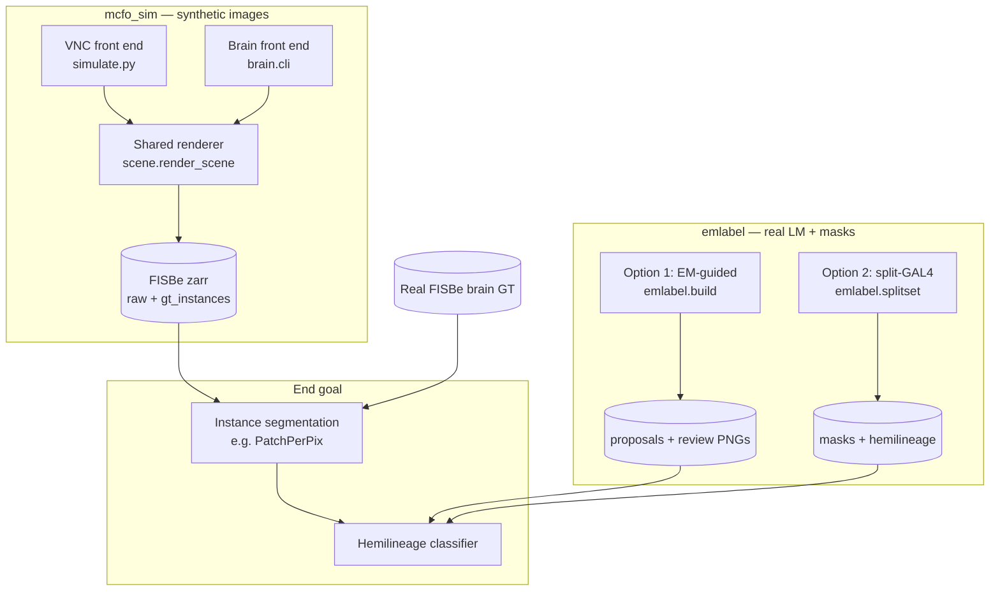
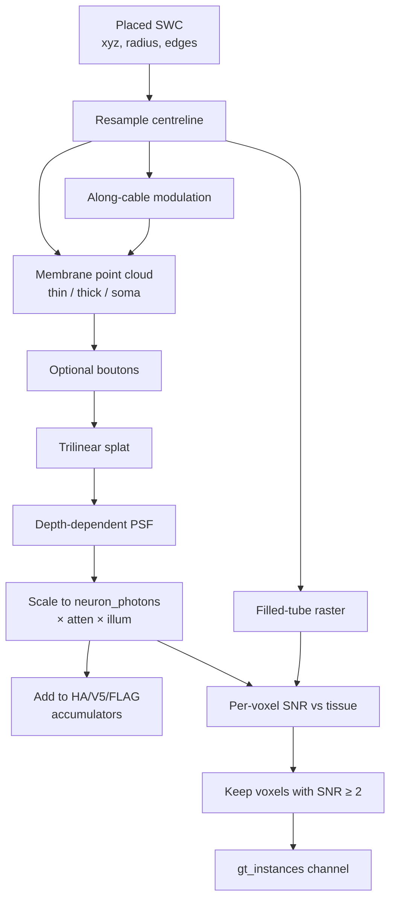
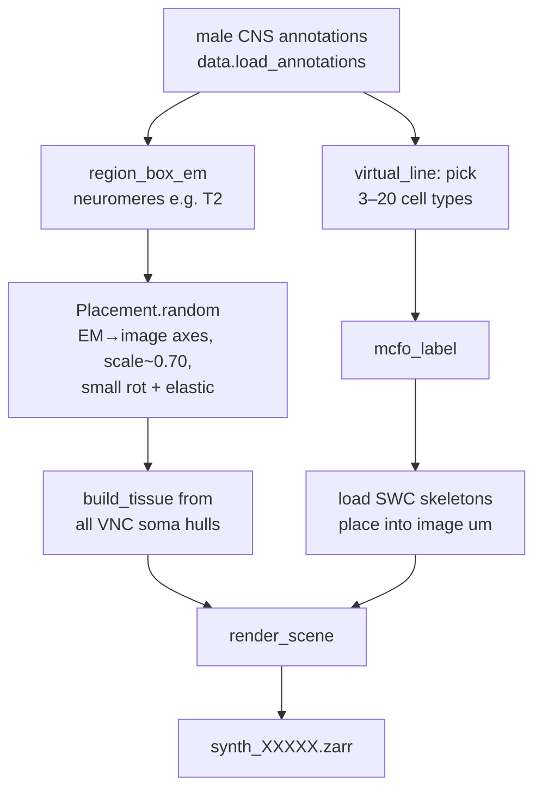
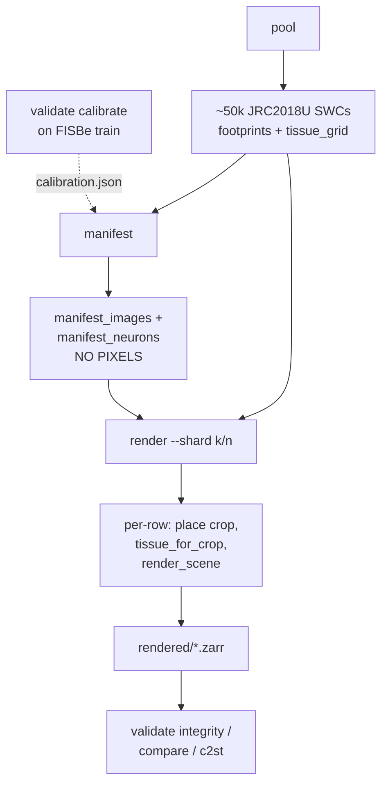
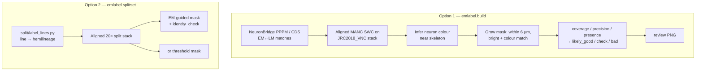

# lm2lineage — How Images Are Generated

This guide explains how `lm2lineage` produces the image stacks and labels used
downstream for neuron instance segmentation and hemilineage classification. It
is meant as a walkthrough of *what* happens to the data and *why*, not as a
duplicate of every function signature (see the source modules and
`CLAUDE.md` for that).

---

## 0. What this project is trying to do

The end goal is: take **FlyLight MCFO confocal images** of the adult
*Drosophila* ventral nerve cord (VNC), segment individual neurons, and assign
each neuron its **hemilineage** (e.g. 03A, 16B). Hand-tracing every neuron is
not planned; the pipeline is designed so a non-expert can accept/reject
automatic proposals.

That creates two complementary data needs:

1. **Large labelled volumes for training a segmenter.** Real hand-labelled MCFO
   is scarce. FISBe provides brain instance GT, but not VNC. So the project
   *synthesizes* MCFO-like stacks from EM connectome skeletons, with perfect
   instance masks, in the same Zarr layout FISBe uses.
2. **Real VNC images with hemilineage labels** (without voxel-perfect instance
   GT). These come from public FlyLight stacks plus automatic mask proposals
   that a human can proofread.

| Package | Role | Pixels |
|---------|------|--------|
| `mcfo_sim/` | Synthetic MCFO from EM skeletons | **Generated** |
| `emlabel/` | Masks + hemilineage on real FlyLight stacks | **Real** (masks proposed) |

Both paths eventually support: segment → classify hemilineage → review.

---

## 1. High-level workflow



**How to read this diagram.** The left side (`mcfo_sim`) invents confocal
volumes from connectome morphology so a network can learn “this cable is one
neuron.” The right side (`emlabel`) never invents pixels; it overlays EM
skeletons on real MCFO/split images and proposes masks whose hemilineage comes
from MANC / male CNS annotations. Real FISBe (brain-only) sits alongside the
synthetic brain set for calibration and evaluation.

Architecture-wise, synthetic generation is deliberately split into:

- **Front ends** that decide *which* neurons appear, where they sit in the
  volume, and what MCFO colours they get.
- A **shared renderer** (`scene.render_scene`) that turns those placed neurons
  into photon fields, detector noise, and FISBe-compatible Zarr.

The VNC front end does design + render in one process. The brain front end
separates design (`manifest`) from rendering so thousands of images can be
planned once and rendered in parallel shards.

### Clarification: both front ends start from SWCs, not EM images

A common confusion is that Front end A (VNC) “starts from EM images” while
Front end B (brain) “starts from SWC files.” **That is not correct.** Neither
path reads greyscale EM volumes. Both start from the same male CNS v1.0
connectome release: a **body-annotation table** plus **per-neuron SWC
skeletons**. The word “EM” here means *EM reconstruction coordinates* (where
the connectome was built), not EM image pixels.

| | Front end A (VNC) | Front end B (brain) |
|--|-------------------|---------------------|
| Source | male CNS v1.0 | male CNS v1.0 |
| Morphology | SWC skeletons | SWC skeletons |
| Metadata | type, hemilineage, soma, … | same |
| SWC directory | `skeletons-malecns` (**raw EM space**, 8 nm → µm) | `skeletons-unisex-template` (**JRC2018U µm**) |
| Not used | greyscale EM volumes | greyscale EM volumes |

What differs is the **coordinate system of those SWCs**, which changes how much
placement work is needed before the shared renderer:

- **VNC** must use raw-EM-space SWCs because the release’s template-space VNC
  skeletons are unreliable (coordinates fall outside JRCVNC2018U). So this path
  remaps axes \((x,y,z)_{\mathrm{EM}} \mapsto (x,z,y)_{\mathrm{image}}\),
  scales by ~0.70 (EM → DPX-cleared LM shrinkage), and invents a crop/tissue
  frame from soma positions. That is “raw-EM SWCs → place into an LM-like
  frame → render,” not “EM images → render.”
- **Brain** can use template-space SWCs already registered to JRC2018U — the
  same template family FlyLight / FISBe use. It skips the EM-axis remap and
  large shrinkage; it mostly crops, adds small jitter, and renders. That is
  why it has a `pool` stage: download ~50k template SWCs once, then design
  many images from footprints.

In short: same *kind* of starting data (SWC + annotations); different *frame*
because trustworthy LM-aligned VNC skeletons are not available from that
template release, while brain ones are.

---

## 2. Synthetic image generation — shared physics

Everything in this section is common to VNC and brain. By the time
`render_scene` runs, each neuron is already a dict with:

- `xyz` — node positions in **image microns**, origin at the stack corner  
  (X = left–right, Y = anterior–posterior, Z = imaging depth);
- `radius` — radius per node (µm);
- `edges` — parent–child links of the SWC tree;
- `soma_idx` — optional index of the soma node;
- `levels` — length-3 vector of HA / V5 / FLAG expression (0 = that tag off);
- `meta` — bodyId, type, hemilineage fields, etc., logged to JSON.

There is also a `Tissue` object (coarse haze / cortex / illumination fields)
and an `ImagingParams` dataclass controlling PSF, noise, and background.

### 2.1 Why a membrane model, not a filled tube for fluorescence

MCFO reporters in Gen1 FlyLight are **myristoylated** smFPs (membrane-targeted).
In real images, thin neurites look solid at light resolution, but thick
processes and somata are often **rim-bright**: most label sits on the surface.
The renderer therefore does **not** dump uniform intensity into a solid cylinder.
It builds a point cloud whose weights approximate **membrane area**, then
splats and blurs that cloud.

### 2.2 Per-neuron fluorescence, step by step

**1. Resample the centreline** (`render.centerline_samples`)  
Each SWC edge is subdivided so samples fall roughly every half voxel. That
yields points, interpolated radii, segment lengths, and local tangent
directions. Working in µm keeps the physics independent of voxel size until
the splat step.

**2. Build membrane points** (`render.membrane_points`)  

- *Thin* neurites (radius below ~0.6× voxel): keep the centreline point and
  weight it by \(2\pi r \cdot ds\) (circumference × length) — the membrane
  area of a short cylinder. After confocal blur, that looks like a solid
  process.
- *Thick* processes: sample a ring of points around the cable (hollow tube)
  so the interior stays dim.
- *Soma*: if present and large enough, sample a spherical shell (Fibonacci-
  like directions) with total weight \(4\pi R^2\).

**3. Modulate brightness along the cable** (`labeling.along_cable_modulation`)  
Real neurons are not uniformly bright. A smooth log-normal field (σ ≈ 0.35,
correlation length ~4 µm) multiplies membrane weights. A small fraction of
cable (~4%) is further dimmed into “gaps,” which helps the segmenter see
broken-looking processes that still belong to one instance.

**4. Optional boutons**  
With probability ~0.6, Poisson-place small spherical beads along thin cable
(rate ~0.25 per µm, with lognormal jitter). Each bead adds membrane-area
weight like a tiny shell. Boutons are also added to the ground-truth tube so
masks cover the visible swellings.

**5. Splat into a local block and blur** (`render.splat`, `imaging.psf_blur`)  
Points are trilinear-splatted into a padded ZYX crop around the neuron, then
blurred with a Gaussian PSF whose σ grows with depth (`deep_blur_factor`).
That approximates confocal blur that worsens deeper in the stack.

**6. Normalize intensity and apply depth / illumination**  
The blurred field is scaled so the median intensity along thin centreline
voxels matches `neuron_photons`. It is then multiplied by exponential depth
attenuation \(\exp(-z / L)\) and by a smooth multiplicative illumination
field from the tissue model. The result is an expected-photon contribution
for this neuron.

**7. Accumulate into colour channels**  
For each tag channel \(c\) with `levels[c] > 0`, the photon field times that
level is added into a global accumulator `acc[c]`. Channels that are off get
nothing from this neuron. Overlaps between neurons simply add in photon space.

**8. Visibility-gated ground truth** (`render.rasterize_mask`)  
Separately from fluorescence, the code rasterizes a **filled** tube (and soma
ball) at the EM radii. For every voxel in that tube it estimates SNR against
local haze/cortex background and read noise. Only voxels with SNR ≥ 2
(`vis_snr`) enter `gt_instances`. Neurons that fall entirely below that
threshold are logged as `not_rendered` rather than written as empty masks —
so GT covers what is *visible*, not invisible cable.



### 2.3 Assembling the full volume

After every neuron has been processed, the renderer builds the observed image
and writes arrays.

**Background.** Tissue haze and cortex fields are upsampled to full
resolution. Haze is multiplied by a fine log-texture field so neuropil does
not look perfectly smooth. Random **speckle** puncta and larger **blobs**
(biased toward cortex) are splatted and blurred into the background.

**Crosstalk.** Expected photons in channel \(c\) are a mix of the neuron
accumulator for \(c\) and bleed from the other channels
(`crosstalk` fraction, typically a few percent).

**Detector** (`imaging.detector`). For each channel:

1. Draw Poisson counts from the expected photon map.
2. Optionally multiply by gamma noise (PMT excess noise).
3. Scale by ADU per photon, add a dark offset, add Gaussian read noise.
4. Round and clip to 12-bit (`max_adu`, normally 4095).

**Auto-gain.** Before detection, a per-channel gain is chosen so the 99.9th
percentile of bright neuron voxels lands near `gain_target` × the usable
dynamic range (defaults aim for roughly 12–60% of full scale). That mirrors
real confocal auto-brightness and keeps synthetic stacks from saturating or
sitting in the noise floor.

**Label maps.** Each visible instance mask is written into one channel of
`gt_instances` (overlaps allowed — two neurons can claim the same voxel).
`gt_labels` is a single map where, on overlaps, the **brighter** instance
(by median SNR) wins. Instances with median SNR below 5 are listed in the
FISBe-style `dim_neurons` attribute.

### 2.4 Output files per sample

Under FISBe layout (`<name>.zarr/volumes/`):

| Array / file | Content |
|--------------|---------|
| `raw` | uint16 `(3, Z, Y, X)` — HA, V5, FLAG |
| `gt_instances` | uint8 `(N, Z, Y, X)` — one binary mask per neuron |
| `gt_labels` | uint16 `(Z, Y, X)` — single label map |
| `<name>.json` | Imaging params, gains, per-instance metadata, overlap stats, skipped neurons |
| `<name>_skeletons.npz` | Centreline voxel coords per instance (for clDice-style metrics) |
| `<name>_mip.png` | Colour MIP next to a coloured GT MIP |

Axes are always stored **CZYX** / **ZYX**. Coordinates in code are µm unless
noted as EM 8 nm voxels.

### 2.5 Domain randomisation (`ImagingParams.random`)

Almost every optical and noise parameter is redrawn per sample: PSF widths,
attenuation length, illumination strength, neuron brightness, haze/cortex
levels (with a random permutation of which channel is “dirtiest”), puncta
densities, crosstalk, texture, gain target, PMT shape, read noise, and dark
offset. The ranges were chosen so noise statistics resemble a real Gen1 40×
VNC tile (dark ~2–3 ADU, dark s.d. ~1.3 ADU, foreground median ~46 ADU,
p99.9 ~1000 ADU). Domain randomisation is intentional: a segmenter should not
overfit one guessed PSF or gain.

Pass `--no-randomize` on the VNC CLI (or fixed params in a brain manifest
row) to use the dataclass defaults.

### 2.6 MCFO labelling model (shared idea; different callers)

`labeling.mcfo_label` implements an MCFO-1-style stochastic reporter model:

- Three independent FRT-stop reporters: HA, V5, FLAG.
- Each is excised in a given cell with probability \(q\).
- \(q\) is set so the expected number of cells with ≥1 tag matches a
  draw from a target visible range:  
  \(P(\text{visible}) = 1 - (1-q)^3\).
- \(q\) is capped (default 0.45) so colours stay mixed even when the expression
  set is small (otherwise almost every cell would be single-colour).
- Expression strength: lognormal per cell type, times lognormal per cell,
  times lognormal per tag, masked by which tags are on.
- Cells with no tags are dropped.

The VNC path calls this after building a virtual GAL4 line. The brain
manifest assigns tags when designing each image (same probabilistic idea,
logged per neuron in `manifest_neurons`).

---

## 3. Front end A — VNC synthetic stacks

**Entry point:** `python -m mcfo_sim.simulate`

This path builds **one sample at a time**: choose a region, invent a line,
label it with MCFO, place skeletons, render. It is aimed at VNC morphology
for eventual VNC segmenter fine-tuning (FISBe itself is brain-only).



### 3.1 Data source and coordinates

Annotations and SWCs come from the public **male CNS v1.0** release (FlyEM) —
the same *kind* of inputs as the brain front end (SWCs + annotations, not EM
images; see the clarification in §1). Skeletons here are the **raw EM space**
set (`skeletons-malecns`). In EM space, axes do not match imaging:

- EM: \(x\) = left–right, \(z\) = long VNC axis, \(y\) = dorso-ventral  
- Image: \(X\) = LR, \(Y\) = AP, \(Z\) = depth  

So placement applies the permutation \((x,y,z)_{\mathrm{EM}} \mapsto (x,z,y)_{\mathrm{image}}\),
then a small random rotation and anisotropic scale.

**Why scale ≈ 0.70?** DPX-cleared LM tissue is smaller than EM tissue.
Fitting raw-EM vs template-space skeletons for brain neurons gives singular
values roughly 0.63–0.79; the default 0.70 (±5% jitter) is that shrinkage.
Radii are scaled the same way.

### 3.2 Region and placement

`region_box_em` builds an EM bounding box from VNC soma positions, tightened
along the long axis to the requested neuromeres (e.g. `T2`). `Placement.random`
centres that box, applies EM→image rotation, scale, optional in-plane spin
(`--inplane-rot` can mimic unaligned tiles), and a smooth elastic warp
(~2.5 µm amplitude). The crop size in image µm becomes the volume shape when
divided by the voxel size (default 0.44 µm isotropic, like Gen1 40×).

### 3.3 Tissue background (VNC)

`build_tissue` uses **all** VNC soma positions (not only labelled neurons) to
estimate:

- **Tissue outline** — convex hull of somata in successive transverse slabs
  along the AP axis (the VNC cross-section is roughly convex; the hull covers
  neuropil + cell-body rind);
- **Cortex** — smoothed soma density (rind-bright background);
- **Haze** — filled tissue mask with smooth multiplicative noise;
- **Illumination** — very smooth multiplicative field.

That background is what SNR gating and detector noise see “under” the neurons.

### 3.4 Virtual GAL4 line + MCFO

`virtual_line` picks \(k\) cell types (default \(k \in [3,20]\)) from
intrinsic / ascending / motor neurons in the neuromere, with a chance of
including a descending type. Every neuron of those types “expresses.”
`mcfo_label` then randomly tags a subset so the expected visible count falls
in a target range (default roughly 4–25).

Skeletons are downloaded/cached on demand (`data.load_skeleton`). Each
labelled body is placed with `Placement`, then handed to `render_scene`.

### 3.5 What this front end does *not* do

- It is **not** in JRC2018 VNC template space. That is fine for learning
  segmentation appearance; for template-space analysis you need a separate
  transform chain (see pitfalls in `CLAUDE.md`).
- Sensory afferents (no VNC soma) are not included yet; they contribute a lot
  of dense tract labelling in real VNC MCFO.
- There is no nc82 / Brp reference channel.

---

## 4. Front end B — Brain / FISBe-style synthetic stacks

**Entry point:** `python -m mcfo_sim.brain.cli <pool|manifest|stats|render|validate>`

This path targets the **central brain** in **JRC2018 unisex** microns — the
same template family FlyLight/FISBe imagery uses. It still starts from male
CNS **SWCs + annotations** (not EM images; see §1), but the SWCs are already
registered (`skeletons-unisex-template`), so there is no EM-axis permutation
like the VNC path. Design is separated from rendering so a 5,000-image set
can be specified once and rendered across many CPUs.



### 4.1 Stage: `pool`

`build_pool` downloads eligible brain SWCs (by superclass / status in
`BrainConfig`), resamples them, and builds:

- a parquet table of neuron metadata;
- **footprints** on a coarse ~4 µm grid (which cells each neuron occupies) —
  used later as a cheap proxy for “do these two neurons come near each other?”;
- a **tissue grid** of occupancy and soma density over the template bbox.

This stage is I/O heavy but cheap per neuron with many download workers. The
config is copied into `pool/config.json`.

### 4.2 Stage: `manifest` (design only — no pixels)

`build_manifest` allocates images over a design grid of **count bins** ×
**overlap modes**, then for each image records everything needed to render
later:

| Design choice | Typical values / meaning |
|---------------|--------------------------|
| Split | train / val / test by **cell type** (80/10/10) so test types never appear in train |
| Crop | ~308×293×173 µm (~700×666×393 voxels at 0.44 µm), central-brain-ish |
| Count bin | 1–2, 3–5, 6–10, 11–20, 21–35, 36–60 neurons |
| Overlap mode | see below |
| Neurons | bodyIds, types, cable-in-crop, MCFO tags and levels |
| Placement | small scale/rotation jitter + elastic warp seed material |
| Imaging | full `ImagingParams` dict (optionally drawn from FISBe calibration) |
| `render_seed` | RNG seed that makes re-renders bit-identical |

**Overlap modes** (footprint-based at design time):

- **isolated** — no two chosen neurons share a dilated footprint neighbourhood;
  capped at modest \(N\) because packing many non-overlapping arbors is hard.
- **natural** — GAL4-like: pick cell types, take their members that fall in
  the crop, then subsample to the target count. Co-fasciculating / co-typed
  neurons overlap “for free.”
- **crowded** — grow a set around a seed, preferring candidates that share
  the most footprint cells with neurons already chosen; with probability
  `same_colour_overlap_p`, force at least one overlapping pair to share the
  same MCFO colour (the hard case FISBe partly-labelled images leave blank).

Manifest outputs (`manifest_images` / `manifest_neurons` as parquet + CSV)
are the authoritative log of which neurons were planned for which image.
`stats` summarises counts, overlap proxies, reuse of bodyIds, and split
leakage.

Optional **`validate calibrate`** on FISBe *train* only measures dark level,
noise, gain targets, and colour multiplicity, writing ranges into
`calibration.json`. The manifest then samples imaging parameters from those
ranges (including MCFO \(q\) inverted from observed multi-colour rates).

### 4.3 Stage: `render`

For each manifest row (optionally filtered by `--ids`, `--first`, or
`--shard k/n`):

1. Rebuild `ImagingParams` and crop geometry from the row.
2. Define a placement function: centre crop → rotate → scale → shift to crop
   origin → add elastic displacement.
3. Build tissue for this crop by resampling the pool’s occupancy/soma grids
   (`tissue_for_crop`) — neuropil haze from closed/filled occupancy, cortex
   from soma density, plus illumination noise.
4. Load each planned SWC, place it, attach that row’s MCFO levels, yield
   neuron dicts.
5. Call the shared `render_scene`.
6. Skip if `<image_id>.json` already exists (resumable).

At 0.44 µm, expect roughly a few minutes and ~10 GB RAM per full-size image;
5,000 images are hundreds of CPU-hours and ~1+ TB. Smaller `crop_um` in the
config makes cheap training patches.

### 4.4 Stage: `validate`

| Check | Purpose |
|-------|---------|
| `integrity` | Instance count, label ids, bodyId set vs manifest, colour consistency on non-overlapping voxels |
| `calibrate` | Fit detector / \(q\) ranges from FISBe train |
| `compare` | Image- and instance-level features vs FISBe; KS / Wasserstein; flag KS > 0.3 |
| `c2st` | Classifier two-sample test on patches (grouped by image); track AUC while tuning |

The decisive downstream check (documented in `README_brain.md`) is whether
training with synthetic data improves PatchPerPix on **real FISBe test**.

### 4.5 Reproducibility guarantees

- Fixed public male CNS v1.0 paths in config.
- Manifest determined by `(config, pool, seed)` — rebuilds are identical.
- Each image’s `render_seed` + stored imaging params → bit-identical `raw`
  and `gt_instances` on re-render (same code/library versions).
- `requirements.txt` pins the tested dependency versions.

---

## 5. Real-image labelling (`emlabel`) — not synthetic pixels

`emlabel` answers a different question: given **real** FlyLight stacks, can we
propose neuron masks and attach hemilineage labels without hand tracing?



### 5.1 Reading real stacks

NeuronBridge aligned stacks are `.h5j` files: HDF5 containers with one HEVC
(H.265) stream per channel (`gray12le`). `emlabel.nb.read_h5j` uses `h5py` +
PyAV, crops padded frames, and returns arrays plus voxel size. JRC2018 VNC
Unisex 40×_DS stacks are typically 573×1119×219 at
**0.461122 × 0.461122 × 0.7 µm**. Signal vs reference channels are marked in
attrs; proposals usually load signal only (full uint16 stacks are ~1 GB).

### 5.2 Option 1 — EM-guided proposals (`emlabel.build`)

NeuronBridge publishes matches between Gen1 MCFO VNC samples and MANC /
FlyEM bodies (PPPM EM→LM, colour-depth search both ways), plus EM skeletons
already in the same template as the stacks.

For one (EM neuron, MCFO sample) pair, `propose`:

1. Resamples the SWC and places it on the stack grid, trying **stated and
   mirrored** orientations (\(x' = W - x\)).
2. Estimates a colour **signature** from bright voxels within ~2.5 µm of the
   skeleton (robust background subtraction per channel).
3. Keeps voxels within a **6 µm tube** of the skeleton that are bright
   (z-score > 5) and colour-similar (cosine ≥ 0.85), retaining connected
   components that touch the near-skeleton zone.
4. Scores:
   - **coverage** — fraction of skeleton length with mask nearby;
   - **precision** — fraction of mask voxels near the skeleton;
   - **presence** — fraction of skeleton with *any* bright signal nearby
     (registration / match sanity check).
5. Auto-flags `likely_good` when coverage ≥ 0.6, precision ≥ 0.6, presence ≥ 0.7
   (else `check` / `likely_bad`), and writes a review PNG
   (raw | raw+skeleton | proposal).

Large crops are **binned in x/y** when they would exceed ~30 M voxels, so
distance transforms stay within RAM.

**Modes:**

- `by-hemilineage` — sample EM neurons per hemilineage, take their top PPPM
  MCFO hits.
- `by-sample` — start from a specific Gen1 line/slide (including local
  collections) and try top colour-depth EM candidates.

Hemilineage comes from male CNS crosswalk `mancBodyid → trumanHl`. Humans
fill `human_verdict` in `proposals.csv`.

**Caveat.** PPPM selected many of these pairs *because* the EM fit the LM, so
high scores validate mask extraction more than independent identity. Use
shuffled EM–LM controls to calibrate flags; real errors are often neighbouring
lookalikes, which are harder than shuffle.

### 5.3 Option 2 — Known-identity split-GAL4 (`emlabel.splitset`)

`split/label_lines.py` maps Meissner et al. split-GAL4 tables to a hemilineage
per line, preferring MANC body ids, then MANC type names, then the paper’s own
label. Descending/sensory lines are dropped, leaving hundreds of VNC lines
(231 single-hemilineage in the shipped table) with aligned 20× stacks.

For each line, `splitset` takes a stack:

- If MANC bodies are known → EM-guided masks + **identity_check** (presence
  ≥ 0.7 means the published type is plausibly in the image).
- Otherwise → strict threshold mask (residual above heavily blurred
  background, high z and relative thresholds) so haze is not mistaken for
  neurons.

These images are **full expression patterns**, not MCFO. Masks are incomplete
or impure relative to every labelled copy in the image. They are useful for
**image-level** hemilineage recognition and classifier evaluation, not as
voxel-perfect instance GT for segmentation training.

---

## 6. How the pieces fit together for training

A practical reading of the overall plan:

1. **Calibrate** the brain simulator against FISBe train (`validate calibrate`
   / `compare` / `c2st`) until intensity and colour statistics are close enough.
2. **Render** a large synthetic brain set (manifest → sharded render).
3. **Train** a segmenter (e.g. PatchPerPix) under regimes such as FISBe-only,
   synthetic-only, pretrain-then-finetune, or mixed batches; evaluate on FISBe
   test with the official instance-segmentation metrics.
4. **Add VNC synthetic** (`simulate`) and/or fine-tune for VNC appearance.
5. **Scale `emlabel`** for real VNC hemilineage-labelled examples; human
   accept/reject proposals.
6. **Classify hemilineage** on segmented neurons (NBLAST/k-NN against
   connectome, and/or direct morphological features), with an `unassigned`
   class for descending/sensory/primary cases.

Synthetic stacks teach *instance separation under MCFO colour and clutter*.
`emlabel` teaches *which morphology maps to which hemilineage on real tissue*.

---

## 7. Code map

| Concern | Files |
|---------|-------|
| Shared render → Zarr / MIP / JSON | `mcfo_sim/mcfo_sim/scene.py` |
| Membrane splat, filled masks | `mcfo_sim/mcfo_sim/render.py` |
| Optics, tissue, detector | `mcfo_sim/mcfo_sim/imaging.py` |
| Virtual lines + MCFO tags | `mcfo_sim/mcfo_sim/labeling.py` |
| EM → image placement (VNC) | `mcfo_sim/mcfo_sim/geometry.py` |
| VNC CLI | `mcfo_sim/mcfo_sim/simulate.py` |
| Consistency checks on synth Zarr | `mcfo_sim/mcfo_sim/verify.py` |
| Brain config / pool / manifest / render / validate / install | `mcfo_sim/mcfo_sim/brain/*.py` |
| SLURM synth chain + install | `sbatch/mcfo/` (`mcfo_submit.sh`) |
| PPP completely+synthetic overlay | `PatchPerPix/.../setup01/datasets_completely_synthetic.toml` |
| `.h5j` I/O, proposals, build, splitset | `emlabel/emlabel/{nb,propose,build,splitset,qc}.py` |
| Split-line hemilineage tables | `emlabel/split/label_lines.py` |

Narrative docs that complement this file:

- `lm2lineage/CLAUDE.md` — goals, data URLs, pitfalls, smoke tests  
- `mcfo_sim/README.md` — VNC simulator quick start  
- `mcfo_sim/README_brain.md` — full brain protocol and validation criteria  
- `emlabel/README.md` — proposal and splitset usage  

---

## 8. Quick commands

Set the import path once (run from the `lm2lineage/` directory, or adjust paths):

```bash
export PYTHONPATH=$PWD/mcfo_sim:$PWD/emlabel
```

Environment notes: Python 3.11; `pip install -r mcfo_sim/requirements.txt`
plus `h5py`, `av`, and `openpyxl` for `emlabel`. Heavy rendering belongs on
local/cluster CPUs, not a login-node chat sandbox.

### 8.1 VNC synthetic — `python -m mcfo_sim.simulate`

```bash
# Coarser voxel for a fast smoke test
python -m mcfo_sim.simulate --out /tmp/vnc --cache data --n 1 --seed 11 --voxel 0.88
python -m mcfo_sim.verify /tmp/vnc/synth_00011.zarr
```

| Flag | Default | Meaning / allowed values |
|------|---------|--------------------------|
| `--out` | `synthetic` | Output directory for `.zarr`, `.json`, MIP, skeletons |
| `--cache` | `data` | Cache dir for the annotation feather + downloaded SWCs |
| `--n` | `1` | Number of samples to generate (integer ≥ 1) |
| `--seed` | `0` | Base RNG seed; sample *i* uses `seed + i` and is named `synth_{seed+i:05d}` |
| `--neuromeres` | `T2` | Comma-separated soma neuromeres to crop around, e.g. `T1`, `T2`, `T3`, `T1,T2` |
| `--voxel` | `0.44` | Isotropic voxel size in µm. `0.44` ≈ Gen1 40×; `0.88` is a 2× faster/cheaper smoke setting |
| `--types` | `3,20` | `min,max` cell types in the virtual GAL4 line (inclusive integers) |
| `--visible` | `4,25` | `min,max` target visible (MCFO-labelled) neurons; drives excision probability *q* |
| `--no-randomize` | off | If set, use fixed `ImagingParams` defaults instead of per-sample domain randomisation |
| `--inplane-rot` | `0.0` | Max random in-plane rotation in degrees about the imaging axis; `~180` mimics unaligned tiles |

`verify` takes one or more paths to synthetic `.zarr` samples (positional args) and
prints a JSON consistency report (instance counts, colour consistency, etc.).

### 8.2 Brain synthetic — `python -m mcfo_sim.brain.cli`

Subcommands: `pool` | `manifest` | `stats` | `render` | `validate` | `install`.

```bash
python -m mcfo_sim.brain.cli pool --cache cache --out pool_small --max-neurons 3000
python -m mcfo_sim.brain.cli manifest --pool pool_small --out man_small --n-images 12
python -m mcfo_sim.brain.cli render --manifest man_small --pool pool_small --cache cache --out r_small --first 3
python -m mcfo_sim.brain.cli validate integrity --rendered r_small --manifest man_small
```

**`pool`** — download template-space SWCs and build footprints / tissue grid.

| Flag | Default | Meaning / allowed values |
|------|---------|--------------------------|
| `--cache` | `cache` | Download cache (annotations + `swc_jrc2018u/`) |
| `--out` | `pool` | Output pool directory (`pool.parquet`, `footprints.npy`, `tissue_grid.npz`, `config.json`) |
| `--max-neurons` | `0` | Cap on eligible neurons; `0` = all (~50k). Use a few thousand for smoke tests |
| `--workers` | `16` | Parallel download / parse workers (positive integer) |
| `--config` | unset | Optional JSON file overriding `BrainConfig` fields (crop size, bins, etc.) |

**`manifest`** — design N images with no pixels rendered.

| Flag | Default | Meaning / allowed values |
|------|---------|--------------------------|
| `--pool` | `pool` | Pool directory from `pool` |
| `--out` | `manifest` | Manifest output dir (`manifest_images` / `manifest_neurons` parquet+CSV) |
| `--n-images` | `5000` | Number of images to design (positive integer; smoke tests use ~12) |
| `--seed` | from config (`20260926`) | Manifest RNG seed; omit to keep the config / pool default |
| `--calibration` | unset | Path to `calibration.json` from `validate calibrate` (constrains imaging / *q* ranges) |
| `--config` | pool’s `config.json` if present | Optional JSON overriding `BrainConfig`; else loads `<pool>/config.json` |

**`render`** — turn manifest rows into FISBe Zarrs (resumable; skips existing `.json`).

| Flag | Default | Meaning / allowed values |
|------|---------|--------------------------|
| `--manifest` | `manifest` | Manifest directory |
| `--pool` | `pool` | Pool directory (tissue grid + config) |
| `--cache` | `cache` | SWC download cache |
| `--out` | `rendered` | Directory for `<image_id>.zarr`, `.json`, MIP |
| `--ids` | all rows | Zero or more image ids to render (space-separated). Default: entire manifest |
| `--first` | unset | Render only the first *N* rows of `manifest_images` (integer). Overrides the default “all” set before sharding |
| `--shard` | unset | `k/n` with integers `0 ≤ k < n`: render rows `k, k+n, k+2n, …` for parallel jobs (e.g. `--shard 0/32` … `--shard 31/32`) |
| `--no-mip` | off | Skip writing `<image_id>_mip.png` |

**`validate <what>`** — positional `what` is one of:

| `what` | Role | Extra flags that matter |
|--------|------|-------------------------|
| `integrity` | Per-image GT / bodyId / colour checks | `--rendered`, `--manifest` |
| `calibrate` | Fit detector / *q* ranges from FISBe **train** | `--fisbe` (dir of `.zarr`), `--out`, optional `--limit` |
| `compare` | Feature KS / Wasserstein vs FISBe | `--fisbe`, `--rendered`, `--out`, optional `--limit` |
| `c2st` | Classifier two-sample test on patches | `--fisbe`, `--rendered`, `--out`, optional `--limit` |

Shared validate flags:

| Flag | Default | Meaning / allowed values |
|------|---------|--------------------------|
| `--rendered` | `rendered` | Directory of synthetic outputs (needed for integrity / compare / c2st) |
| `--manifest` | unset | Manifest dir (required for a full integrity bodyId check) |
| `--fisbe` | unset | Directory of real FISBe `.zarr` samples (calibrate / compare / c2st) |
| `--out` | `validation` | Where to write `calibration.json`, comparison tables, `c2st.json`, etc. |
| `--limit` | unset | Cap how many images/patches to process (integer; useful for quick checks) |

**`stats`** (not in the smoke block): `--manifest` (default `manifest`), optional
`--rendered` to add planned-vs-visible and realised-overlap summaries.

**`install`** — symlink rendered Zarrs into `fisbe/<dataset>/{train,val,test}/`
by the manifest `split` column (no data copy).

| Flag | Default | Meaning / allowed values |
|------|---------|--------------------------|
| `--manifest` | `manifest` | Manifest dir with `manifest_images.parquet` |
| `--rendered` | `rendered` | Dir containing `<image_id>.zarr` |
| `--fisbe-root` | `fisbe` | Parent of `<dataset>/{train,val,test}` |
| `--dataset` | `synthetic` | Dataset folder name under `fisbe-root` |
| `--force` | off | Replace existing symlinks that point elsewhere (never deletes real dirs) |
| `--dry-run` | off | Print planned links / sample-list edits only |
| `--update-sample-list` | unset | Path to `sample_list_per_split.txt`; rewrites the FlyLight `<dataset>` section |

### 8.3 Real EM-guided proposals — `python -m emlabel.build`

Subcommands: `by-sample` | `by-hemilineage`.

```bash
cd emlabel && python -m emlabel.build by-sample \
  --line R74B04 --slide 20190927_61_H3 --top 3 --out /tmp/bs
```

**`by-sample`** — start from one Gen1 MCFO line/slide; try top colour-depth EM candidates.

| Flag | Default | Meaning / allowed values |
|------|---------|--------------------------|
| `--line` | *(required)* | FlyLight GAL4 / Gen1 line name, e.g. `R74B04` |
| `--slide` | *(required)* | Slide / sample id for that line, e.g. `20190927_61_H3` |
| `--top` | `10` | How many EM candidates to try (positive integer; smoke uses `3`) |
| `--out` | `proposals` | Output dir (`proposals.csv`, `review/*.png`, caches) |
| `--cache` | `cache` | Download cache for stacks / SWCs / NeuronBridge JSON |

**`by-hemilineage`** — sample EM neurons per hemilineage; take their top PPPM MCFO hits.

| Flag | Default | Meaning / allowed values |
|------|---------|--------------------------|
| `--hemilineages` | *(empty = all)* | Comma-separated Truman hemilineages, e.g. `01A,03A,06B,16B` |
| `--per-hemilineage` | `1` | How many EM neurons to draw per hemilineage |
| `--top` | `2` | PPPM MCFO matches per EM neuron |
| `--seed` | `0` | RNG seed for which EM neurons are sampled |
| `--out` | `proposals` | Same as `by-sample` |
| `--cache` | `cache` | Same as `by-sample` |

### 8.4 SLURM: brain synth chain (`sbatch/mcfo/`)

Parameterized jobs under [`sbatch/mcfo/`](../sbatch/mcfo/). Shared defaults live in
`mcfo_env.sh`. The submitter chains:

```text
pool → manifest → render array (--shard k/N) → integrity
```

From the **repo root**:

```bash
# Smoke-scale (defaults: MAX_NEURONS=3000, N_IMAGES=12, N_SHARDS=3)
RUN_DIR=lm2lineage/runs/brain_smoke2 ./sbatch/mcfo/mcfo_submit.sh

# Dry-run (prints sbatch lines; does not submit)
./sbatch/mcfo/mcfo_submit.sh --dry-run

# Production-ish
RUN_DIR=lm2lineage/runs/brain_5k N_IMAGES=5000 N_SHARDS=32 MAX_NEURONS=0 \
  ./sbatch/mcfo/mcfo_submit.sh

# Include fisbe install at the end of the chain
WITH_INSTALL=1 RUN_DIR=lm2lineage/runs/brain_smoke2 ./sbatch/mcfo/mcfo_submit.sh

# Or install after integrity finishes
AFTER_JOB=<integrity_jobid> ./sbatch/mcfo/mcfo_submit.sh install
```

| Env var | Default | Role |
|---------|---------|------|
| `RUN_DIR` | `lm2lineage/runs/brain_v1` | Working directory (cache/pool/manifest/rendered) |
| `CACHE` / `POOL_OUT` / `MANIFEST_OUT` / `RENDER_OUT` | under `RUN_DIR` | Stage paths |
| `MAX_NEURONS` | `3000` | Pool size cap; `0` = all eligible |
| `N_IMAGES` | `12` | Manifest image count |
| `N_SHARDS` | `3` | Render array length (`--shard k/N_SHARDS`) |
| `WORKERS` | `16` | Pool download threads |
| `CALIBRATION` | empty | Optional `calibration.json` for manifest |
| `RENDER_PCT` | `8` | Array concurrency `%N` |
| `PARTITION` / `ACCOUNT` | `cs` / `torch_pr_61_general` | SLURM account/partition |
| `WITH_INSTALL` | `0` | `1` → also submit `install_fisbe.sbatch` after integrity |
| `FISBE_ROOT` / `DATASET` | `fisbe` / `synthetic` | Install targets |
| `FORCE_INSTALL` | `0` | Pass `--force` to install |

Runtime for synth jobs: conda env `lm2lineage` (not Singularity). Logs go to
`sbatch/mcfo/logs/`. The older one-shot
`lm2lineage/runs/brain_smoke/smoke.sbatch` is left as a legacy all-in-one job.

### 8.5 PPP: install → prepare → train/eval

After render + integrity (and preferably `mcfo_submit.sh install`):

```bash
# 1) Symlink rendered zarrs into fisbe/synthetic/{train,val,test}/ by split
./sbatch/mcfo/mcfo_submit.sh install
# (or: WITH_INSTALL=1 on the synth chain)

# 2) Add PPP training arrays (raw_normalized, gt_instances_rm_5, …)
DATASETS=synthetic sbatch sbatch/ppp/prep/prepare_fisbe_for_ppp_sbatch.sh

# 3) Pack train_ppp.tar / val_ppp.tar for STAGE_DATA jobs
DATASETS=synthetic sbatch sbatch/ppp/prep/prepare_ppp_stage_tars_sbatch.sh
# or DATASETS=completely,synthetic …
```

Train / array with both completely and synthetic (all splits):

```bash
./sbatch/ppp/ppp_submit.sh train <preset> \
  --datasets completely,synthetic \
  --config datasets_completely_synthetic.toml

./sbatch/ppp/ppp_submit.sh array <preset> --split val --ckpt N \
  --datasets completely,synthetic \
  --config datasets_completely_synthetic.toml
```

Test-only synthetics (legacy Phase 2) still use
`datasets_test_synthetic.toml` and only need `fisbe/synthetic/test/`.

Install updates
`evaluate-instance-segmentation/assets/sample_list_per_split.txt` (and mirrors
into `fisbe/sample_list_per_split.txt` when that file exists).

---

## 9. Pitfalls that affect “how images look”

These show up repeatedly when interpreting outputs; details and citations live
in `CLAUDE.md`.

- **Template-space VNC skeletons** from male CNS `skeletons-unisex-template`
  are not trustworthy for JRCVNC2018U. VNC work in LM space should use
  NeuronBridge MANC SWCs (or a proper transform chain).
- **PPPM body ids** for VNC are tied to older FlyEM_VNC_v0.5 numbering; presence
  scoring catches ids that changed meaning under MANC.
- **Hemilineage name clashes** across papers (e.g. “16A” vs MANC 16B) —
  prefer MANC-derived labels.
- **Visibility gating** means a rendered image can have fewer instances than
  the manifest planned; check `not_rendered` in the JSON and `stats --rendered`.
- **Split-line masks** are not MCFO instance GT; do not train a colour-aware
  instance segmenter on them as if they were FISBe.
