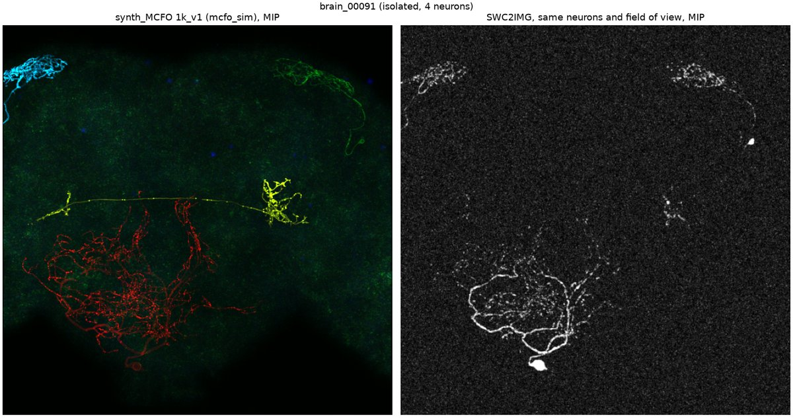
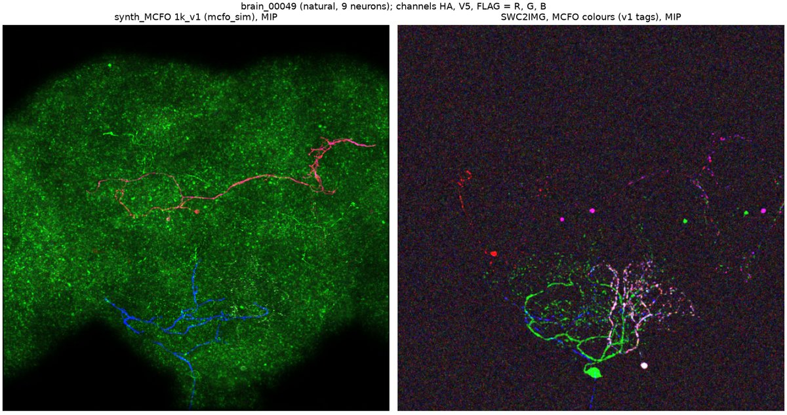
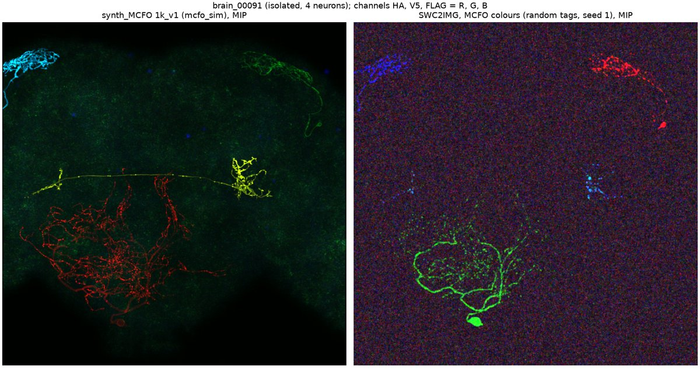

# SWC2IMG vs synth_MCFO 1k_v1 — notes and findings

Author: Gaurav Wadhwa · Started 2026-11-05 · Status: first renders done, full-dataset batch job not run yet

How to run the tool: [README.md](README.md). Theory, findings and next steps: [NOTES.md](NOTES.md).
found so far.

## 1. The task

Task list for **SWC2IMG**:

| # | Task | Status |
|---|---|---|
| 1 | Use it with Python | Done: `python -m swc2img_py ...` runs SWC2IMG through Fiji |
| 2 | Place multiple neurons in the same image | Done: all neurons of a v1 image, at their real relative positions |
| 3 | Colour neurons RGB randomly, like MCFO | Done: v1's tags (`--tags v1`) or new random tags (`--tags random --seed N`) |
| 4 | Recreate one v1 image | Done for brain_00091, brain_00049 and brain_00381 (same neurons, same field of view) |
| 5 | Recreate the entire v1 dataset | Not yet: needs a batch job on Greene (see §6) |

Input: the neuron-set bundle `1k_v1_neuron_sets` (`images.csv`, `neurons.csv`, `swc/` with 970 skeletons, 3 rendered
examples).

**Both sides of the comparison are synthetic.** v1 comes from our own simulator (`lm2lineage/mcfo_sim`); the other side
comes from SWC2IMG, an off-the-shelf ImageJ plugin. Both start from the same skeletons. Neither is a real microscope
image; real FISBe data is the reference for judging which is better (§6).

## 2. How an image is made

### 2.1 Input: SWC skeletons
An SWC file is a text list of points: `id type x y z radius parent`. Each point links to its parent, so the points
form a tree of tubes that traces the neuron. The skeletons come from the male CNS EM connectome v1.0 and are
registered to the JRC2018 unisex template in micrometres. Combining several neurons therefore keeps their real
positions relative to each other.

### 2.2 Pipeline

```
images.csv ─► pick the image's neurons ─► merge their SWCs ─► clip to the v1 field of view
                                                              + add 2 near-invisible corner anchors
           ─► Fiji / SWC2IMG renders a 3D stack ─► crop to the v1 box using the anchors
           ─► TIFF + max projection + side-by-side with the v1 render
```

- **Merge** (`swc.merge`): node ids are renumbered so neurons don't clash; roots stay roots.
- **Clip** (`swc.clip_to_box`): nodes outside the v1 box (plus a 5 µm margin) are dropped, so we don't render cable we
  would crop away.
- **Anchors** (`swc.with_anchors`): SWC2IMG sizes the image to the data extent plus a border and shifts coordinates.
  Two tiny nodes (radius 0.001 µm) at the box corners fix the extent. Their positions in SWC2IMG's "corrected SWC"
  output give the exact crop offset, so the result lines up voxel for voxel with the v1 render (same shape, e.g.
  394 × 687 × 688 at 0.44 µm).
- **Render** (`fiji.run_swc2img`): Python writes an ImageJ macro and runs Fiji's bundled Java:
  `run("SWC2IMG", "file=[...] lateral=0.44 axial=0.44 background=10 correlation=0.5 snr=10 save correct log")`.
  The rendering itself is done by ImageJ, not Python.

### 2.3 What SWC2IMG does inside (theory)
SWC2IMG (Radojević & Meijering, Erasmus MC) synthesises a fluorescence-like image from an SWC:
1. **Partial-volume rasterisation:** for every voxel it estimates what fraction of the voxel is inside the neuron's
   tubes. Inside a thick branch → 1, edge of a thin neurite → a small fraction.
2. **Intensity:** background voxels get the `background` level (we used 10). Neuron voxels are scaled by the occupied
   fraction, with the neuron level set from `snr`, defined as SNR = (neuron mean − background) / √(neuron mean).
3. **Noise:** Poisson-like noise on every voxel.
4. **Correlation:** a Gaussian blur of σ = `correlation` µm (we used 0.5), so the noise isn't independent per voxel.
   This is the only blur. There is no explicit optical point-spread function.
5. **Output:** 32-bit float stack, one channel, one SWC per run.

### 2.4 MCFO colour (task 3)
MCFO-1 labels each neuron with a random subset of three tags (HA, V5, FLAG), shown as R, G, B. SWC2IMG has one channel,
so we run it three times per image:
- **HA channel:** only the neurons tagged HA.
- **V5 channel:** only the neurons tagged V5.
- **FLAG channel:** only the neurons tagged FLAG.

Stacked, a neuron with HA+FLAG appears in red and blue (magenta). Each channel gets its own independent SWC2IMG noise,
as in a real 3-channel scan.
- `--tags v1`: tags from `neurons.csv`, the same colours as the v1 render.
- `--tags random`: an MCFO-1 draw. Each tag is on independently with probability q = 0.45, redrawn until ≥ 1 tag is
  on (same idea as `mcfo_sim/labeling.py`).

### 2.5 How our v1 simulator differs (from `lm2lineage/IMAGE_GENERATION.md`)

| | SWC2IMG | mcfo_sim (v1) |
|---|---|---|
| Fluorescence model | filled tube, ∝ voxel occupancy | membrane label ∝ surface area (rim-bright thick processes, thin neurites kept visible) |
| Brightness | same for every neuron | log-normal per neuron, per tag and along the cable; gaps; boutons |
| Optics | Gaussian noise correlation only | depth-dependent PSF, attenuation, uneven illumination |
| Background | flat level + noise | tissue haze with texture, cortex, speckles, blobs, channel crosstalk |
| Detector | Poisson-like noise | Poisson + PMT gain noise + read noise, auto-gain, 12-bit |
| Colour | via 3 renders (this tool) | built in (MCFO-1 model) |
| Ground truth | the SWC only | per-neuron masks, cut to the visible part (SNR ≥ 2) |
| Placement | template coordinates as-is | plus ±3° rotation, ±3 % scale, ~2 µm warp, radii × 0.75 |

## 3. Findings so far (visual comparison only)

All panels are max-intensity projections. Left: v1; right: SWC2IMG with the same neurons and field of view.

**brain_00091** (isolated, 4 neurons), greyscale


**brain_00049** (natural, 9 neurons), MCFO colours using v1's tags


**brain_00091**, random MCFO tags (seed 1)


More: [brain_00049 greyscale](docs/images/brain_00049_grey_compare.jpg),
[brain_00381 greyscale](docs/images/brain_00381_grey_compare.jpg).

Observations:
1. **Alignment works.** Neurons sit in the same places as in v1, so the two renders can be compared voxel for voxel.
2. **Thin neurites fade or break up in SWC2IMG.** With 0.44 µm voxels and radii ~0.25 µm, a thin neurite fills only
   a small part of each voxel, so it falls near the noise. Example: the long thin axon of the yellow neuron in
   brain_00091 is almost invisible. v1 keeps such processes visible.
3. **Thick processes and cell bodies saturate in SWC2IMG** (full voxel occupancy), giving a high-contrast,
   "blobby" look.
4. **Every neuron is equally bright in SWC2IMG.** In v1 some neurons are much dimmer (per-neuron expression), so
   SWC2IMG shows more neurons and more cell bodies than v1 for the same image.
5. **No tissue background in SWC2IMG.** v1's haze, texture and speckles (e.g. the green haze in brain_00049) are
   missing. There is only flat correlated noise.
6. MCFO colour mixing behaves as expected: two-tag neurons show mixed colours, and colours match v1 when using v1
   tags.

Caveats: the comparison is visual only, with no numbers yet. The SWC2IMG settings (background 10, SNR 10,
correlation 0.5 µm) are my choice, not tuned. We used radius × 1.0 (v1 used 0.75) and no placement jitter.

## 4. Cost (laptop, 7.7 GB RAM)
- Greyscale image at 0.44 µm: ~70 s, ~0.75 GB TIFF.
- RGB image: ~3–6 min, ~2.2 GB TIFF. Memory is the limit.
- Whole 1k_v1 in RGB: ~50 h single-threaded, ~2.2 TB uncompressed. Needs Greene, compressed Zarr output, and many
  parallel jobs.

## 5. Setup notes / gotchas
- **No `--headless`:** SWC2IMG's dialog has AWT buttons, so Fiji `--headless` throws `HeadlessException`. We use
  `ij.ImageJ -batch` with `setBatchMode(true)`, which still needs a display. On Greene use `xvfb-run -a`.
- **Log via file:** the Windows Fiji launcher (`fiji-windows-x64.exe`) doesn't block or print to a captured console,
  and Fiji's stdout is empty when captured from Python. The macro therefore writes Fiji's log to
  `<name>.swc2img.log`, and the plugin's `log` option must be on.
- **Install:** `SWC2IMG_-1.1.0.jar` goes in `Fiji/plugins/`; `ImageScience-3.1.0.jar` goes in `Fiji/jars/`.

## 6. Next steps
1. **Batch job (task 5):** SLURM array over `images.csv` on Greene with `xvfb-run`, writing FISBe-layout Zarr
   (`volumes/raw` 3×Z×Y×X, plus per-neuron masks from per-neuron renders) so PatchPerPix / BiaPy / `evalinstseg` can
   use it unchanged.
2. **Numbers, not just pictures:** intensity and SNR statistics, and the fraction of each v1 `gt_instances` mask that
   is visible in SWC2IMG.
3. **Realism vs real data:** run `mcfo_sim`'s `validate compare` / `c2st` on SWC2IMG renders and v1 renders against
   FISBe train.
4. **The decisive test:** train a segmenter on SWC2IMG data vs v1 data and score both on FISBe test with
   `evalinstseg`.
5. **Tune SWC2IMG** (SNR, background, radius scale) to see how close it can get to v1.

## 7. Proposed experiments (draft)

### 7.1 Simulator ladder: which rendering components matter for sim-to-real?
Render the same 1k_v1 neuron sets with increasingly realistic simulators, train a segmenter on each, and score it on
real FISBe test.

| Rung | Renderer | Status |
|---|---|---|
| 0 | SWC2IMG, greyscale | renders work (this folder) |
| 1 | SWC2IMG + MCFO colour | renders work (this folder) |
| 2 | v1 minus one component at a time: membrane model, per-neuron brightness, tissue background, depth PSF, boutons | needs switches in `mcfo_sim` |
| 3 | full v1 (mcfo_sim) | exists |
| 4 | v1 + learned translation to real FlyLight appearance (CycleGAN/CUT or mask-conditioned diffusion) | future |

- **Training:** for each rung, synthetic-only, and synthetic pretrain → FISBe fine-tune. Baseline is FISBe-only.
- **Model and metrics:** PatchPerPix (best FISBe baseline). Score with `evalinstseg` on FISBe test: S, avF1, C,
  clDice, FS/FM, overall and on dim neurons.
- **Claim we want to support:** which physical components of the simulator drive transfer to real data.

### 7.2 Which realism metric predicts usefulness?
For every rung, compute realism scores against **FISBe train only**:
- `mcfo_sim` `validate compare` (KS / Wasserstein on intensity, contrast, background, texture, neurite diameter,
  colour);
- `validate c2st` (AUC);
- KID/FID on MIPs.

Then correlate each score with the downstream FISBe test score from 7.1. Question: is "looks more real" (low C2ST AUC)
the same as "is more useful"? This also answers how close the synthetic data is to the real dataset.

### 7.3 Rough timeline
- **Minimal (1 seed, 4–6 rungs): ~2 weeks.**
  - Days 1–2: Zarr output + batch renders.
  - Days 2–4: v1 ablation renders.
  - Days 3–10: training, ~1.5 GPU-days per rung (24 h pretrain + 8 h fine-tune + eval).
  - Days 4–6: realism metrics.
  - Days 11–13: analysis and plots.
- **Full (3 seeds, ~7 rungs, CIs, scaling 500/1k/2.5k): ~4–6 weeks**, ~30 GPU-days.
- **Main risks:** Greene queue times, and PPP pipeline fixes for new data.

## References
- SWC2IMG: https://imagescience.org/meijering/software/swc2img/ — cite M. Radojević and E. Meijering, "Automated Neuron
  Reconstruction from 3D Fluorescence Microscopy Images Using Sequential Monte Carlo Estimation", *Neuroinformatics*
  17(3):423–442, 2019.
- Skeletons: male CNS connectome v1.0 (Janelia FlyEM et al., CC-BY), bioRxiv 10.1101/2025.10.09.680999.
- Neuron sets and v1 renders: synth_MCFO 1k_v1 (`lm2lineage/mcfo_sim`).
- MCFO: Nern, Pfeiffer & Rubin, PNAS 2015.
