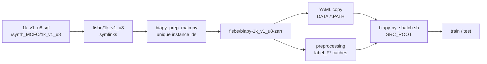
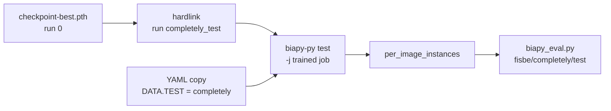
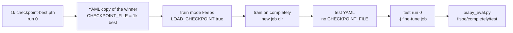

# Use `1k_v1_u8` in the BiaPy pipeline

Plan for training and testing BiaPy on `fisbe/1k_v1_u8` the same way the
current configs train on `fisbe/completely`.

`1k_v1_u8` is already a FISBe-layout Zarr tree (CZYX `volumes/raw` and
`volumes/gt_instances`, splits `train` / `val` / `test`). BiaPy does not
read that tree. It trains on a second tree of ZYXC Zarrs produced by
`biapy_work_folder/biapy_prep_main.py`. Today that second tree, the YAMLs,
and the train sbatch all point at completely.

Related: [`ppp_prep.md`](../ppp/ppp_prep.md) (how `1k_v1_u8` is built and
why its arrays are SquashFS symlinks),
[`raytune_biapy_scheduler_only.md`](raytune_biapy_scheduler_only.md)
(preprocessing must exist before train).

---

## What already matches

| | completely | `1k_v1_u8` |
|---|---|---|
| Root | `fisbe/completely/{train,val,test}/*.zarr` | `fisbe/1k_v1_u8/{train,val,test}/*.zarr` |
| Arrays BiaPy prep reads | `volumes/raw`, `volumes/gt_instances` | same keys |
| Channels | 3 (CZYX) | 3 (HA, V5, FLAG), from the synth writer |
| Sample list | section `(1)` of `evaluate-instance-segmentation/assets/sample_list_per_split.txt` | section `(7)` |
| Counts | 18 train / 5 val / 7 test | 797 train / 110 val / 95 test |

Prep is already dataset-agnostic. `biapy_prep_main.py` globs `*.zarr` under
each split, reads those two arrays, merges instance channels, transposes
raw `CZYX → ZYXC`, and writes `{split}/raw` and `{split}/label`.

---

## What has to change



1. Mount the SquashFS before anything opens a volume.
2. Fix the instance-id merge, then materialize a BiaPy tree.
3. Point a YAML copy and the train sbatch at that tree.
4. Preprocess channel GT, then train and test with test `IN_MEMORY` off.
5. Evaluate against `fisbe/1k_v1_u8/test` with the SquashFS mounted.

---

## 1. Mount the SquashFS

`volumes/raw` and `volumes/gt_instances` under `fisbe/1k_v1_u8` are
symlinks into `/synth_MCFO/1k_v1_u8`. They resolve only while
`/scratch/vh2308/data/synth_MCFO/1k_v1_u8.sqf` is an overlay. The web job
and `sbatch/ppp/prep/synth/build_synth_from_sqf_sbatch.sh` already mount
it. A bare `python biapy_prep_main.py` on a login node does not.

Run prep on a compute node, inside a container that mounts the image
read-only (`--overlay …/1k_v1_u8.sqf:ro`), the same mount path the synth
build uses. There is no BiaPy sbatch for this step yet.

---

## 2. Instance ids before the full convert

`merge_instance_masks` in `biapy_work_folder/biapy_prep_utils.py` copies
each channel’s voxel values into one `uint16` ZYX volume:

```python
merged[instance_ids] = mask[instance_ids]  # instance_ids = mask > 0
```

The synth writer (`lm2lineage/mcfo_sim/mcfo_sim/scene.py`) stores a
**binary** mask per neuron (`0` or `1`) in `volumes/gt_instances`. Unique
ids go in a separate `volumes/gt_labels` array (uint16, brightest neuron
wins overlaps). `build_synth_vh.py` only symlinks `raw` and
`gt_instances`, so `gt_labels` is not exposed under `fisbe/1k_v1_u8`
even when the SquashFS has it.

If the channels are binary, the current merge writes `1` for every
neuron. BiaPy then trains a single instance per brain. Official eval
avoids that in `binary_masks_to_uniq_ids`
(`evaluate-instance-segmentation/evalinstseg/util.py`), which multiplies
channel `i` by `i + 1` and keeps the channels separate. BiaPy wants one
label volume, so the merge has to assign `i + 1` wherever channel `i` is
nonzero. A voxel in two neurons can keep only one id. Last-channel-wins
matches the current loop. Brightest-wins matches `gt_labels`.

Check one mounted sample before converting the set:

- `volumes/raw` shape is CZYX with `C = 3`, and spatial size is at least
  the patch `(Z, Y, X) = (80, 128, 128)`.
- `volumes/gt_instances` max. A max of `1` means the merge must assign
  channel index `+ 1`. A max that is already a unique id per channel
  means the current merge is enough.
- Whether `volumes/gt_labels` exists in the SquashFS sample. If it does,
  linking it and using it as the label volume is the brightness-ordered
  alternative.

`uint16` is enough: synth images are designed for on the order of 1–60
neurons (`lm2lineage/mcfo_sim/README_brain.md`).

Prep loads each volume with `np.array`. Do the one-sample check first.
Then, with augmentations left off (BiaPy augments at train time; the
completely configs read `fisbe/biapy-no-aug-zarr`):

```bash
python biapy_work_folder/biapy_prep_main.py \
  -i fisbe/1k_v1_u8 \
  -o fisbe/biapy-1k_v1_u8-zarr \
  -s train val test
```

Write the new tree under `fisbe/`. That directory is gitignored with the
rest of the dataset.

---

## 3. YAML and train staging

Active configs hardcode the completely tree. Copy one (for example
`biapy_work_folder/configs/biapy-aug-zarr-seunet-FDcDn-skel.yaml`) and
retarget every split:

```yaml
DATA:
  PATCH_SIZE: (80, 128, 128, 3)   # ZYXC; last dim is the 3 MCFO channels
  TRAIN:
    PATH: fisbe/biapy-1k_v1_u8-zarr/train/raw
    GT_PATH: fisbe/biapy-1k_v1_u8-zarr/train/label
    INPUT_IMG_AXES_ORDER: ZYXC
    INPUT_MASK_AXES_ORDER: ZYXC
  VAL:
    PATH: fisbe/biapy-1k_v1_u8-zarr/val/raw
    GT_PATH: fisbe/biapy-1k_v1_u8-zarr/val/label
    # same axes
  TEST:
    PATH: fisbe/biapy-1k_v1_u8-zarr/test/raw
    GT_PATH: fisbe/biapy-1k_v1_u8-zarr/test/label
    IN_MEMORY: false          # true loads the whole split; this split is 95 volumes
    LOAD_GT: true
```

Train does not keep those paths. `sbatch/biapy/biapy-py_sbatch.sh` stages
train and val from a fixed root:

```bash
SRC_ROOT="fisbe/biapy-no-aug-zarr"
```

`run_biapy-py.py` (`apply_stage_path_overrides`) then points `DATA.TRAIN`
and `DATA.VAL` at that staged copy. `SRC_ROOT` has to be the new tree, or
a 1k YAML still trains on completely. Preprocessing and test read the
YAML paths directly. Preprocessing writes the `label_F*` caches next to
`GT_PATH`, and the train job requires exactly one matching cache
(`label_F*_Dc*_Dn*_Sk*_I` when skeleton recall is on). Run preprocessing
on the new tree before train.

The YAMLs set no `DATA.NORMALIZATION`. Prep writes `raw` unchanged.
Completely raw in `fisbe/biapy-no-aug-zarr` is uint16. `1k_v1_u8` raw is
uint8 (PPP prep uses `CLIPMAX=255` for it). BiaPy 3.7.0 fills in the
default `zero_mean_unit_variance` with `MEAN_VAL` / `STD_VAL` left at
`-1` (see the resolved copy under
`metrics/biapy/biapy-1k_v1_u8-seunet-FDcDn-skel/config_files/`). Those
stats are not a frozen uint8 scale stored next to the checkpoint.
Section 6 scores this checkpoint on completely test with no further
training. Section 7 trains it on completely train, then scores the same
test split.

---

## 4. Disk, preprocessing, train, test

| Step | Scale vs completely |
|---|---|
| Prep output | 1,002 volumes instead of 30 |
| Preprocessing caches | 797 train + 110 val, plus F / Dc / Dn / skeleton channels |
| Train staging | rsync of train and val raw plus one `label_F*` dir onto `$SLURM_TMPDIR` |
| Test | 95 volumes. Leave `DATA.TEST.IN_MEMORY` false |

`biapy-py_sbatch_chain.sh` gives preprocessing 8 CPUs, 14 hours, and
256 GB. That budget is for the completely caches. Check free space on
the node-local SSD before train: staging copies the train and val raw
volumes and the channel-GT caches, and this set is 907 volumes in those
two splits.

Order, from the repo root, after the tree exists and `SRC_ROOT` matches it:

```bash
./sbatch/biapy/biapy-py_sbatch_chain.sh <new-stem> preprocessing
./sbatch/biapy/biapy-py_sbatch_chain.sh <new-stem> train test
```

`<new-stem>` is the basename of the YAML copy under
`biapy_work_folder/configs/`.

---

## 5. Eval and the viewer

`evalinstseg` matches each prediction stem to
`{gt_folder}/{stem}.zarr`. Point `--gt_file` at `fisbe/1k_v1_u8/test` and
`--gt_key` at `volumes/gt_instances`. That job mounts `1k_v1_u8.sqf` too.
Section `(2)` of the sample list (partly labeled) has no `brain_*`
names, so these samples are not flagged partly labeled. BiaPy still
writes TIFFs, so `biapy_work_folder/evalinstseg_prep_zarr.py` stays in
front of scoring.

The web job already mounts this SquashFS and the sample list already
includes section `(7)`. Predictions show up by filename. No extra
dataset wiring in `web/server/services/biapy_loader.py`.

`evaluate-instance-segmentation/biapy_eval.py` is the wrong scorer for
this split. It always reads ground truth from `fisbe/completely/{split}`.
Use it for the completely cross-test in section 6. Scoring `1k_v1_u8`
still needs `--gt_file fisbe/1k_v1_u8/test` and the SquashFS mount.

---

## 6. Test the 1k checkpoint on completely/test

`biapy-1k_v1_u8-seunet-FDcDn-skel.yaml` tests the synthetic split
(`fisbe/biapy-1k_v1_u8-zarr/test`, 95 `brain_*` volumes). Test mode reads
`DATA.TEST` from the YAML, so submitting that stem as `test` runs the
synthetic split. Completely needs its own YAML copy.

The trained run is job `biapy-1k_v1_u8-seunet-FDcDn-skel`, run id `0`.
Weights are:

```text
metrics/biapy/biapy-1k_v1_u8-seunet-FDcDn-skel/checkpoints/biapy-1k_v1_u8-seunet-FDcDn-skel_0-checkpoint-best.pth
```

BiaPy replaces that file whenever validation loss improves. Hardlink it
only after the train job has exited. A link made while training is still
writing keeps the weights from that moment.

Completely test for BiaPy is already materialized (7 volumes, names match
`fisbe/completely/test`):

```text
fisbe/biapy-no-aug-zarr/test/raw
fisbe/biapy-no-aug-zarr/test/label
```



### 6.1 YAML copy

Copy the 1k YAML to
`biapy_work_folder/configs/biapy-1k_v1_u8-seunet-FDcDn-skel-completely-test.yaml`.
Change only the test block. Leave the model, watershed (`Dc`/`Dn` seeds),
and `remove_small_objects: 1000` as they are. In test mode
`run_biapy-py.py` forces `TRAIN.ENABLE: false`, `TEST.ENABLE: true`, and
`MODEL.LOAD_CHECKPOINT: true`, so the train and val paths in the copy
are ignored.

```yaml
  TEST:
    PATH: fisbe/biapy-no-aug-zarr/test/raw
    GT_PATH: fisbe/biapy-no-aug-zarr/test/label
    INPUT_IMG_AXES_ORDER: ZYXC
    INPUT_MASK_AXES_ORDER: ZYXC
    IN_MEMORY: true          # 7 volumes; the 1k YAML uses false because that split has 95
    LOAD_GT: true
    PADDING: (4,16,16)
```

### 6.2 Checkpoint and submit

BiaPy loads `{job}_{run}-checkpoint-best.pth`. A new run id keeps these
predictions out of `results/…_0`. `-j` stays the trained job name so
checkpoints and results stay under
`metrics/biapy/biapy-1k_v1_u8-seunet-FDcDn-skel/`.

From the repo root, after the train job exits:

```bash
ln \
  metrics/biapy/biapy-1k_v1_u8-seunet-FDcDn-skel/checkpoints/biapy-1k_v1_u8-seunet-FDcDn-skel_0-checkpoint-best.pth \
  metrics/biapy/biapy-1k_v1_u8-seunet-FDcDn-skel/checkpoints/biapy-1k_v1_u8-seunet-FDcDn-skel_completely_test-checkpoint-best.pth

./sbatch/biapy/biapy-py_sbatch_chain.sh \
  -j biapy-1k_v1_u8-seunet-FDcDn-skel \
  -r completely_test \
  biapy-1k_v1_u8-seunet-FDcDn-skel-completely-test test
```

Instance TIFFs:

```text
metrics/biapy/biapy-1k_v1_u8-seunet-FDcDn-skel/results/biapy-1k_v1_u8-seunet-FDcDn-skel_completely_test/per_image_instances/
```

Stems are the completely names (`JRC_SS04989-20160318_24_A2`, `R14A02-…`,
and the other five).

### 6.3 Score with evaluate-instance-segmentation

`sbatch/evalinstseg/evalinstseg_sbatch.sh` is hardcoded to
`biapy-v1-no-aug`. Submit the same container with this run.
`biapy_eval.py` converts `per_image_instances` TIFFs to integer-label
Zarrs, then calls `evalinstseg.evaluate_file`. Ground truth is
`fisbe/completely/test/<stem>.zarr`, key `volumes/gt_instances`.
Localization is clDice, assignment is greedy.

```bash
sbatch --job-name=EI-1k-completely-test \
  --cpus-per-task=4 --time=04:00:00 --mem=32g \
  --account=torch_pr_61_general \
  --output=sbatch/evalinstseg/%x-%j.out \
  --error=sbatch/evalinstseg/%x-%j.err \
  --wrap 'singularity exec --overlay env/evaluate.ext3:ro /share/apps/images/cuda12.1.1-cudnn8.9.0-devel-ubuntu22.04.2.sif /bin/bash -c "source /ext3/env.sh; conda activate evalinstseg; cd evaluate-instance-segmentation; python -u biapy_eval.py --config-name=biapy-1k_v1_u8-seunet-FDcDn-skel --job-name=biapy-1k_v1_u8-seunet-FDcDn-skel --run-id=completely_test --split=test --from-scratch"'
```

One TOML per volume:

```text
metrics/biapy/biapy-1k_v1_u8-seunet-FDcDn-skel/results/biapy-1k_v1_u8-seunet-FDcDn-skel_completely_test/eval-inst_metrics/test/
```

Each file has `general` (`avg_f1_cov_score`, skeleton coverage, false
merge, false split) and `confusion_matrix`. Scores stay per volume.
These TOMLs are the no-completely-training baseline for section 7.

Read the numbers with two limits in mind:

- `biapy_eval.py` scores `per_image_instances`. With instance refinement
  on, BiaPy also writes `per_image_instances_post_processing`
  (`remove_small_objects: 1000`). Scoring uses the unrefined folder, then
  drops components smaller than 500 voxels
  (`remove_small_components=500`).
- Completely raw is uint16 and the 1k training raw is uint8. The resolved
  training config uses `zero_mean_unit_variance` with mean and std at
  `-1`, and no `normalization_*.npy` sits next to the checkpoint.

---

## 7. Fine-tune the 1k checkpoint on completely/train

Start from the section 6 weights, train on completely train (18 volumes),
and score completely test (7 volumes). The synthetic run stays in its own
directory. This stage writes a new job under `metrics/biapy/`.

`biapy_work_folder/configs/biapy_fcdcdn_skel_l40s_c3_winner.yaml` is the
same seunet, `F`/`Dc`/`Dn` channels, patch `(80, 128, 128, 3)`, watershed,
and one-cycle settings as `biapy-1k_v1_u8-seunet-FDcDn-skel.yaml`, with
`DATA.*` already on `fisbe/biapy-no-aug-zarr`. Copy that file. Copying the
1k YAML instead leaves `DATA.*` on `fisbe/biapy-1k_v1_u8-zarr`.

With `MODEL.SAVE_CKPT_FREQ` at its default, the 1k run only stores the
best validation file:

```text
metrics/biapy/biapy-1k_v1_u8-seunet-FDcDn-skel/checkpoints/biapy-1k_v1_u8-seunet-FDcDn-skel_0-checkpoint-best.pth
```

`MODEL.LOAD_CHECKPOINT_ONLY_WEIGHTS` defaults to true, and the 1k YAML
does not set it, so the checkpoint carries that default. BiaPy then loads
weights, builds a new AdamW, and starts at epoch 0. The one-cycle schedule
runs again for `TRAIN.EPOCHS`. The file’s `epoch` field is the string
`"best"`, so a full state resume would still start the epoch loop at 0.

BiaPy checks the checkpoint against the new YAML for problem type,
dimension, patch size, and `DATA_CHANNELS` only. Data paths can change.
On load it also copies the checkpoint’s `MODEL` block over the YAML, then
sets `LOAD_CHECKPOINT` back to true. Architecture follows the 1k
checkpoint. `LOAD_CHECKPOINT_ONLY_WEIGHTS: false` in the fine-tune YAML
does not stick: the copied block puts the default `true` back.



### 7.1 Train YAML

Copy the winner YAML to
`biapy_work_folder/configs/biapy-ft-completely-from-1k_v1_u8-seunet-FDcDn-skel.yaml`.
Leave `DATA.TRAIN`, `DATA.VAL`, and `DATA.TEST` on
`fisbe/biapy-no-aug-zarr`. Add:

```yaml
MODEL:
  LOAD_CHECKPOINT: true
  LOAD_CHECKPOINT_ONLY_WEIGHTS: true

PATHS:
  CHECKPOINT_FILE: metrics/biapy/biapy-1k_v1_u8-seunet-FDcDn-skel/checkpoints/biapy-1k_v1_u8-seunet-FDcDn-skel_0-checkpoint-best.pth
```

`PATHS.CHECKPOINT_FILE` is a read path. Do not hardlink the 1k file onto
this job’s `{job}_{run}-checkpoint-best.pth`. Training overwrites that
name when validation loss improves, and a hardlink shares the 1k inode,
so the synthetic checkpoint would be replaced. Section 6 can hardlink
because that run only reads.

Completely train is 18 volumes, not 797. The copied schedule is still 240
epochs at `3.3e-4`. That is a second full training run from these
weights. Lower `TRAIN.EPOCHS` and `TRAIN.LR` in this YAML for a shorter
fine-tune. The new job name is the YAML stem, so outputs go to
`metrics/biapy/biapy-ft-completely-from-1k_v1_u8-seunet-FDcDn-skel/` and
the 1k directory is left as it is.

### 7.2 Train mode must keep `LOAD_CHECKPOINT`

`apply_mode_overrides` in `biapy_work_folder/run_biapy-py.py` sets
`MODEL.LOAD_CHECKPOINT` to false on every train launch. A YAML `true` is
dropped, and the job trains from scratch. The log line
`Mode overrides (train): ... MODEL.LOAD_CHECKPOINT=False` means the 1k
weights were not loaded.

Change the train branch so a YAML `true` is kept. Test mode can keep
forcing `LOAD_CHECKPOINT` on. After the change, the train log should
contain `Loading checkpoint from file` and `Model weights loaded!`.

### 7.3 Train

`sbatch/biapy/biapy-py_sbatch.sh` stages train and val from
`SRC_ROOT`, default `fisbe/biapy-no-aug-zarr`. Leave that default. An
exported `SRC_ROOT=fisbe/biapy-1k_v1_u8-zarr` would fine-tune on the
synthetic tree again. `apply_stage_path_overrides` then points
`DATA.TRAIN` and `DATA.VAL` at the staged copy. `DATA.TEST` stays on the
YAML.

Staging requires exactly one `label_F*_Dc*_Dn*_Sk*_I` directory under
both `fisbe/biapy-no-aug-zarr/train` and `.../val`. Those caches come from
the completely `F`/`Dc`/`Dn` plus skeleton-recall preprocessing. Skip
preprocessing when that directory is already the only match.

From the repo root, after the 1k train job has exited and the runner
keeps `LOAD_CHECKPOINT`:

```bash
./sbatch/biapy/biapy-py_sbatch_chain.sh \
  biapy-ft-completely-from-1k_v1_u8-seunet-FDcDn-skel train
```

The fine-tuned weights:

```text
metrics/biapy/biapy-ft-completely-from-1k_v1_u8-seunet-FDcDn-skel/checkpoints/biapy-ft-completely-from-1k_v1_u8-seunet-FDcDn-skel_0-checkpoint-best.pth
```

At the end of training BiaPy reloads `PATHS.CHECKPOINT_FILE` into memory
for the BMZ export. That reload reads the 1k file again. The fine-tuned
file above is the one written when validation loss improved. Test has to
load that file.

### 7.4 Test on completely/test

A `train test` chain on the train YAML still has `CHECKPOINT_FILE` aimed
at the 1k checkpoint, so the test job scores the synthetic weights.
`PATHS.CHECKPOINT_FILE` wins over the fine-tune job’s own checkpoint
directory.

Copy the train YAML to
`biapy-ft-completely-from-1k_v1_u8-seunet-FDcDn-skel-test.yaml` and remove
`PATHS.CHECKPOINT_FILE`. Leave `DATA.TEST` on
`fisbe/biapy-no-aug-zarr/test` with `IN_MEMORY: true` (7 volumes). Test
mode forces `LOAD_CHECKPOINT: true`. With an empty `CHECKPOINT_FILE`,
`LOAD_CHECKPOINT_EPOCH` defaults to `best_on_val` and loads
`{job}_0-checkpoint-best.pth` from the job directory.

`-j` is the fine-tune job name, not the test YAML stem. `-r 0` matches
the file train just wrote:

```bash
./sbatch/biapy/biapy-py_sbatch_chain.sh \
  -j biapy-ft-completely-from-1k_v1_u8-seunet-FDcDn-skel \
  -r 0 \
  biapy-ft-completely-from-1k_v1_u8-seunet-FDcDn-skel-test test
```

Instance TIFFs:

```text
metrics/biapy/biapy-ft-completely-from-1k_v1_u8-seunet-FDcDn-skel/results/biapy-ft-completely-from-1k_v1_u8-seunet-FDcDn-skel_0/per_image_instances/
```

### 7.5 Score

Same scorer as section 6.3. `biapy_eval.py` reads ground truth from
`fisbe/completely/test` and predictions from
`metrics/biapy/<config-name>/results/<job-name>_<run-id>/per_image_instances`.
Both name flags are the BiaPy job name, not the test YAML stem.

```bash
sbatch --job-name=EI-1k-ft-completely \
  --cpus-per-task=4 --time=04:00:00 --mem=32g \
  --account=torch_pr_61_general \
  --output=sbatch/evalinstseg/%x-%j.out \
  --error=sbatch/evalinstseg/%x-%j.err \
  --wrap 'singularity exec --overlay env/evaluate.ext3:ro /share/apps/images/cuda12.1.1-cudnn8.9.0-devel-ubuntu22.04.2.sif /bin/bash -c "source /ext3/env.sh; conda activate evalinstseg; cd evaluate-instance-segmentation; python -u biapy_eval.py --config-name=biapy-ft-completely-from-1k_v1_u8-seunet-FDcDn-skel --job-name=biapy-ft-completely-from-1k_v1_u8-seunet-FDcDn-skel --run-id=0 --split=test --from-scratch"'
```

TOMLs:

```text
metrics/biapy/biapy-ft-completely-from-1k_v1_u8-seunet-FDcDn-skel/results/biapy-ft-completely-from-1k_v1_u8-seunet-FDcDn-skel_0/eval-inst_metrics/test/
```

Compare each volume with the section 6 TOML of the same stem. Section 6
is the 1k checkpoint on completely test. This directory is that
checkpoint after completely train. Scoring uses `per_image_instances`,
then drops components smaller than 500 voxels, same as section 6.

---

## Checklist

- [ ] One mounted sample: raw shape `C=3` and spatial size ≥ `(80, 128, 128)`, `gt_instances` max, `gt_labels` present or absent.
- [ ] Merge assigns a unique id per neuron (or the check showed ids are already unique).
- [ ] `fisbe/biapy-1k_v1_u8-zarr/{train,val,test}/{raw,label}` written from a job that mounts `1k_v1_u8.sqf`.
- [ ] YAML copy with `DATA.*.PATH` / `GT_PATH` on that tree, and `DATA.TEST.IN_MEMORY: false`.
- [ ] `SRC_ROOT` in `sbatch/biapy/biapy-py_sbatch.sh` is the same tree.
- [ ] Preprocessing finished; train staging resolves exactly one `label_F*` directory.
- [ ] Node-local disk fits the staged train and val raw plus that cache.
- [ ] Test and `evalinstseg` run with the SquashFS mounted and `--gt_file fisbe/1k_v1_u8/test`.
- [ ] Train job exited, then `…_0-checkpoint-best.pth` hardlinked to `…_completely_test-checkpoint-best.pth`.
- [ ] YAML copy `biapy-1k_v1_u8-seunet-FDcDn-skel-completely-test.yaml` with `DATA.TEST` on `fisbe/biapy-no-aug-zarr/test` and `IN_MEMORY: true`.
- [ ] Test submitted with `-j biapy-1k_v1_u8-seunet-FDcDn-skel -r completely_test`.
- [ ] `biapy_eval.py` scored `per_image_instances` against `fisbe/completely/test` into `eval-inst_metrics/test/`.
- [ ] Fine-tune YAML copied from `biapy_fcdcdn_skel_l40s_c3_winner.yaml`, with `DATA.*` on `fisbe/biapy-no-aug-zarr`, `MODEL.LOAD_CHECKPOINT: true`, and `PATHS.CHECKPOINT_FILE` on the 1k `…_0-checkpoint-best.pth`.
- [ ] Train mode in `run_biapy-py.py` keeps a YAML `LOAD_CHECKPOINT: true`. The train log shows `Model weights loaded!`.
- [ ] Train submitted with `SRC_ROOT` left at `fisbe/biapy-no-aug-zarr`, and exactly one `label_F*_Dc*_Dn*_Sk*_I` under train and val.
- [ ] Test YAML has no `PATHS.CHECKPOINT_FILE`, submitted with `-j` the fine-tune stem and `-r 0`.
- [ ] `biapy_eval.py` scored that fine-tune run against `fisbe/completely/test` into the fine-tune job’s `eval-inst_metrics/test/`.
