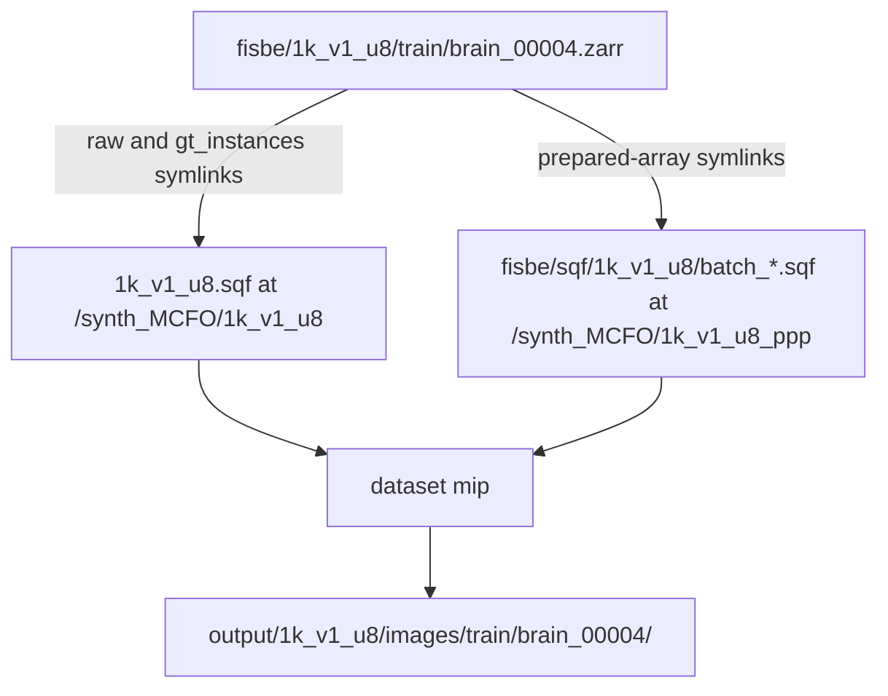

# Imaging helpers

Figures and a volume inventory for FISBe Zarrs, SquashFS-backed synth sets
(`1k_v1`, `1k_v1_u8`), BiaPy outputs, and PatchPerPix training snapshots.
This does not train or evaluate a model. It reads arrays already on disk and
writes PNGs or a CSV.

Entry point, from the repo root:

```bash
python -m imaging_helpers_hpc <command> ...
```

Commands: `dataset`, `fisbe`, `any`, `ppp`, `biapy`, `stats`.
A separate script, `check_gt_instance_connectivity.py`, is not part of that CLI.

Sqf-backed datasets must be read inside the container that mounts the images.
Use [`sbatch/ppp/prep/synth/inspect_sqf_dataset_sbatch.sh`](../../sbatch/ppp/prep/synth/inspect_sqf_dataset_sbatch.sh)
for `dataset`. The `ppp` overlay is Python 3.9; the helpers parse on that
interpreter. The job sets `MPLBACKEND=Agg` so Matplotlib can write PNGs with
no display.

---

## 1. Where files go

Every CLI run creates `imaging_helpers_hpc/output/images/` and overwrites
`imaging_helpers_hpc.txt` in the working directory.

| Command | Writes |
|---------|--------|
| `dataset inventory` | `imaging_helpers_hpc/output/sqf_dataset_inventory.csv` |
| `dataset mip` | `imaging_helpers_hpc/output/<dataset>/images/<split>/<sample>/<sample>_<array>.png` |
| `fisbe`, `any`, `ppp`, `biapy` 4-pane | `imaging_helpers_hpc/output/images/` |
| `biapy` watershed | `imaging_helpers_hpc/output/<config>/<run>/<sample>/<product>.png` |
| connectivity script | `imaging_helpers_hpc/output/gt_instance_connectivity.csv` |

`dataset mip` puts one sample in its own folder. For train `brain_00004` on
`1k_v1_u8` the six default PNGs are:

```text
imaging_helpers_hpc/output/1k_v1_u8/images/train/brain_00004/
  brain_00004_raw.png
  brain_00004_gt_instances.png
  brain_00004_raw_normalized.png
  brain_00004_gt_instances_rm_5.png
  brain_00004_gt_numinst.png
  brain_00004_gt_fg_rm_5.png
```

Logs for the sbatch job are `sbatch/ppp/logs/ppp_inspect_sqf-<jobid>.{out,err}`.

---

## 2. Workflow


1. Pick a source. Real Zarrs under `fisbe/<dataset>/{train,val,test}/`, a
   TIFF/NRRD/NPY/HDF, a BiaPy result tree, or a PPP snapshot HDF.
2. The command opens that file. Inventory reads only the Zarr header
   (shape, dtype, chunks). MIP commands copy one volume into memory.
3. A projector collapses Z. Color volumes stay CZYX and project axis 1.
   Scalar volumes (`gt_numinst`, `gt_fg_rm_5`) are ZYX and project axis 0.
4. The PNG is written under `imaging_helpers_hpc/output/`. The next sample
   starts only after the current array is released.

`dataset mip` does this once per requested array, one brain at a time.
Default `--limit` is 3 brains per dataset. Pass `--sample` for one brain.



`volumes/raw` and `volumes/gt_instances` point at the source image
`/scratch/vh2308/data/synth_MCFO/<dataset>.sqf`. The four prepared arrays
point at `/synth_MCFO/<dataset>_ppp/...`, which is
`fisbe/sqf/<dataset>/batch_*.sqf`. The inspect job mounts both. If a
prepared-array symlink points at `/synth_MCFO/` and no shard exists, the job
stops and prints:

```bash
DATASETS=1k_v1_u8 sbatch sbatch/ppp/prep/pack_ppp_sqf_sbatch.sh
```

Build the skeleton first with
[`build_synth_from_sqf_sbatch.sh`](../../sbatch/ppp/prep/synth/build_synth_from_sqf_sbatch.sh)
when `fisbe/<dataset>/{train,val,test}` does not exist yet. Prep order is in
[`ppp_prep.md`](../ppp/ppp_prep.md).

---

## 3. How a figure is made

Projectors live in [`imaging_helpers_hpc/imaging.py`](../../imaging_helpers_hpc/imaging.py).
Loaders live in [`imaging_helpers_hpc/loading.py`](../../imaging_helpers_hpc/loading.py).

| Array | Layout | Figure |
|-------|--------|--------|
| `raw`, `raw_normalized` | CZYX. `raw_normalized` is float32, clipped then divided by `CLIPMAX` (255 on uint8 synth). | Color Z MIP, shared contrast across channels (`gen_basic_mip`, axis 1). |
| `gt_instances`, `gt_instances_rm_5` | CZYX labels. `gt_instances_rm_5` is a copy of `gt_instances`. The opening is only on the foreground mask. | One colored Z MIP. Channels are collapsed by keeping the highest label id at each pixel (`gen_instance_projection`, axis 1). Colors are chosen again on every run. |
| `gt_numinst` | ZYX uint8, count of labeled channels at each voxel. | Grayscale Z MIP (`gen_scalar_mip`, axis 0). |
| `gt_fg_rm_5` | ZYX float32 foreground mask after a radius-1 opening. | Grayscale Z MIP (`gen_scalar_mip`, axis 0). |

`--dpi` on `dataset mip` (default 100) applies to all six. The other CLI
commands keep the plotter default of 800.

A full brain is cast to float32 for the color MIP. The inspect job asks for
64 GB so one brain fits. Do not point this at all ~1000 training brains
unless you raise the time limit. `--limit 3` or `--sample` is the check.

---

## 4. `dataset`

Inspect any folder under `fisbe/` whose splits are `train`, `val`, and
`test`. For `1k_v1` and `1k_v1_u8`, submit the sbatch so the SquashFS images
are mounted. From the repo root:

```bash
# Header only: shape, dtype, chunks, symlink target. No voxel reads.
DATASETS=1k_v1_u8 sbatch sbatch/ppp/prep/synth/inspect_sqf_dataset_sbatch.sh

# One brain, all six arrays.
MODE=mip SAMPLE=brain_00004 SPLITS=train DATASETS=1k_v1_u8 \
  sbatch sbatch/ppp/prep/synth/inspect_sqf_dataset_sbatch.sh

# Three val brains, raw only.
MODE=mip SPLITS=val DATASETS=1k_v1 LIMIT=3 \
  sbatch sbatch/ppp/prep/synth/inspect_sqf_dataset_sbatch.sh
```

The sbatch variables are `DATASETS` (default `1k_v1,1k_v1_u8`), `MODE`
(`inventory` or `mip`), `SPLITS` (default `train val test`), `SAMPLE`,
`LIMIT` (default 3), and `DPI` (default 100). CPU job, 4 cores, 64 GB,
4 hours, partition `cs`.

Direct CLI, once the same images are mounted:

```bash
python -m imaging_helpers_hpc dataset inventory \
  --datasets 1k_v1_u8 --splits train val test

python -m imaging_helpers_hpc dataset mip \
  --datasets 1k_v1_u8 --splits train --sample brain_00004 --dpi 100
```

Inventory `--arrays` defaults to `raw,gt_instances`. MIP `--arrays` defaults
to `raw,gt_instances,raw_normalized,gt_instances_rm_5,gt_numinst,gt_fg_rm_5`.
An unknown name, a missing array, or a dangling symlink stops the MIP.
Inventory records the open error in the CSV `status` column and continues.

CSV columns: `dataset`, `split`, `sample`, `array`, `shape`, `dtype`,
`chunks`, `symlink_target`, `status`.

---

## 5. Other commands

These read ordinary files. They do not mount a SquashFS image. Run them from
the repo root in an environment that has `zarr`, `numpy`, and `matplotlib`
(`conda activate ppp` inside the container is the one used on Greene).

### `fisbe`

One sample of `fisbe/completely` only. `--input-file` is `split/stem` with
no `.zarr`. `--volume` is accepted and unused.

| Mode | What it writes |
|------|----------------|
| `mip-gt` | Raw color MIP and a ground-truth label MIP. |
| `rotate` | Same pair after one shared 90-degree rotation. |
| `channel` | Raw MIP with the three channels permuted. |

```bash
python -m imaging_helpers_hpc fisbe -m mip-gt -i train/JRC_SS04989-20160318_24_A2
```

Use `dataset` for `partly`, `synth_vh`, `1k_v1`, or `1k_v1_u8`.

### `any`

One Z MIP of a TIFF, NRRD, NPY, or HDF file. 3D arrays are treated as XYZ
and flipped to ZYX. HDF needs `--dataset` when `/volumes/` has more than one
dataset. Affinity stacks with more than three channels are reduced with max.

```bash
python -m imaging_helpers_hpc any -i path/to/volume.hdf -d volumes/raw
```

### `ppp`

Four-panel MIP of a training snapshot HDF: raw RGB, `pred_numinst`
argmax, `gt_numinst`, and the mean absolute error between `pred_affs` and
`gt_affs`. A missing dataset leaves that panel blank. `-i` is one
`snapshot_*.hdf` or a directory of them. How training writes the HDF and
how this command draws it is in
[`ppp_snapshot_images.md`](ppp_snapshot_images.md).

```bash
python -m imaging_helpers_hpc ppp -m snapshot-mip \
  -i metrics/ppp/<exp_id>/train/snapshots
```

A directory writes
`imaging_helpers_hpc/output/<exp_id>_snapshots/<stem>.png`. One HDF writes
`imaging_helpers_hpc/output/images/ppp_snapshot_<stem>.png`.

### `biapy`

`4-pane-mip` loads test raw, per-image probabilities, and instance labels
for config `-c` (default `biapy-v1-no-aug`) from
`biapy_work_folder/results/<config>/results/<config>_1/`. It draws the third
sample in sorted order (index 2), not `--sample`. The PNG is
`imaging_helpers_hpc/output/images/mip_<sample>.png` with raw, foreground
channel, contour channel, and instances.

`watershed` reads
`metrics/biapy/<config>/results/<config>_<run>/watershed/<sample>/<product>.tif`.
`--watershed` is `seed_map` (default), `growth_mask`, or
`topografic_surface`. The surface uses a min-projection with a terrain
colormap. The other two use the label projector. An empty `--sample` walks
every sample directory and all three products.

```bash
python -m imaging_helpers_hpc biapy -m 4-pane-mip -c biapy-v1-no-aug

python -m imaging_helpers_hpc biapy -m watershed -c biapy-v1-no-aug -r 0 \
  -s JRC_SS04989-20160318_24_A2.zarr -w seed_map
```

### `stats`

Prints shape, dtype, and unique values for one TIFF, or for each image in a
directory. `.zarr` is rejected. Output is the log, not a PNG.

```bash
python -m imaging_helpers_hpc stats -i path/to/file.tif
```

---

## 6. Ground-truth connectivity

[`imaging_helpers_hpc/check_gt_instance_connectivity.py`](../../imaging_helpers_hpc/check_gt_instance_connectivity.py)
walks `fisbe/completely/{train,val,test}` and writes one CSV row per
non-empty `gt_instances` channel: voxel count, number of 26-connected
components, and the fraction of voxels in the largest component. It reads
voxels. It uses the compute-node Python that already has `zarr` and `scipy`,
not the `ppp` container, and it does not follow `/synth_MCFO` symlinks.

```bash
sbatch sbatch/ppp/prep/fisbe/check_gt_instance_connectivity_sbatch.sh
```

That job is 32 cores, 128 GB, 2 hours. The CSV is
`imaging_helpers_hpc/output/gt_instance_connectivity.csv`.
