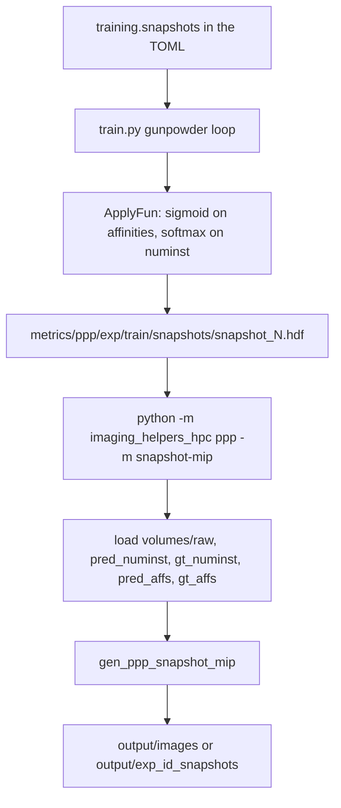

# PPP training snapshots to PNGs

A training snapshot is one crop from the gunpowder training loop, written as
HDF5 so you can see what the network is predicting while it trains. This
command does not run inference on a full brain and it does not read
checkpoints. It reads `snapshot_*.hdf` files that `train` already wrote and
saves a four-panel max-intensity projection.

The rest of the imaging CLI (FISBe, synth datasets, BiaPy) is in
[`imaging_helpers.md`](imaging_helpers.md). Training launch and experiment
layout are in [`ppp_overview.md`](../ppp/ppp_overview.md).

---

## 1. Where the files are

Training is started from `PatchPerPix/experiments/` with
`--root ../../metrics/ppp` (the default in
[`sbatch/ppp/ppp_job.sh`](../../sbatch/ppp/ppp_job.sh)). For experiment
`<exp_id>` the snapshot directory is:

```text
metrics/ppp/<exp_id>/train/snapshots/snapshot_<iteration>.hdf
```

`run_ppp.py` creates that directory in `create_folders`. The filename
template is `snapshot_{iteration}.hdf`. Cadence is the TOML key
`training.snapshots` (iterations between writes). Current presets use
`2000` or `5000`. A debug run forces `snapshots = 10` in
`setDebugValuesForConfig`.

Each file is the crop requested on that iteration: raw at the network input
size, predictions and labels at the network output size. Those two sizes
differ by the valid-convolution padding, so the raw panel and the prediction
panels are the same crop with different spatial extent. They are separate
projections, not a registered overlay.

A single HDF still writes one PNG under a fixed folder relative to the
working directory:

```text
imaging_helpers_hpc/output/images/ppp_snapshot_<stem>.png
```

`snapshot_5001.hdf` becomes
`imaging_helpers_hpc/output/images/ppp_snapshot_snapshot_5001.png`.

Passing the snapshots directory writes one PNG per `snapshot_*.hdf` into a
folder named from the experiment id (the path component after `ppp`):

```text
imaging_helpers_hpc/output/<exp_id>_snapshots/<stem>.png
```

`metrics/ppp/our-decoder-c1k_v1/train/snapshots/snapshot_5001.hdf` becomes
`imaging_helpers_hpc/output/our-decoder-c1k_v1_snapshots/snapshot_5001.png`.
The CLI also overwrites `imaging_helpers_hpc.txt` in the working directory.

---

## 2. Pipeline



1. During `train`, gunpowder keeps a batch in memory. Every
   `training.snapshots` iterations it activates the network outputs, applies
   sigmoid or softmax, and writes the arrays listed in `snapshot_datasets`.
2. After at least one HDF exists, run the imaging CLI on that file or on the
   snapshots directory. A file writes one PNG under `output/images`. A
   directory writes one PNG per `snapshot_*.hdf` under
   `output/<exp_id>_snapshots/`.
3. The helper never starts training and never writes back into
   `metrics/ppp/`.

---

## 3. How training writes the HDF

The nodes are at the end of the training pipeline in
[`PatchPerPix/experiments/flylight/setups/setup01/train.py`](../../PatchPerPix/experiments/flylight/setups/setup01/train.py).

`gp.ApplyFun` runs on the same cadence as the snapshot. It turns logits into
the values stored on disk:

| Array | Function |
|-------|----------|
| `pred_affs` | sigmoid |
| `pred_numinst` | softmax over the channel axis |
| `pred_fgbg` | sigmoid, when `overlapping_inst` is false |

`gp.Snapshot` then writes `output_folder/snapshots/snapshot_{iteration}.hdf`.
`output_folder` for training is `metrics/ppp/<exp_id>/train`.
`pred_numinst` and `pred_fgbg` are stored as float32.

Datasets under `/volumes/` depend on the model flags. Current base TOMLs set
`overlapping_inst = true`, which is the case the four-panel figure is built
for.

| HDF dataset | Written when | What it is |
|-------------|--------------|------------|
| `volumes/raw` | always | input crop |
| `volumes/pred_affs` | always | predicted affinities after sigmoid |
| `volumes/gt_affs` | always | ground-truth affinity samples for that crop (`gt_affs_samples` in the pipeline) |
| `volumes/pred_numinst` | `overlapping_inst` | softmax over instance-count classes |
| `volumes/gt_numinst` | `overlapping_inst` | ground-truth instance count |
| `volumes/pred_fgbg`, `volumes/gt_fgbg` | `overlapping_inst` is false | foreground probability and mask |
| `volumes/pred_code` | `train_code` | predicted patch code |

With `train_code = true`, the snapshot request marks `pred_affs` and
`gt_affs_samples` nonspatial. Those datasets are sampled affinity vectors,
while `volumes/pred_code` is the spatial code volume. The four-panel loader
expects spatial 3D or 4D arrays for the affinity panel.

On disk a spatial array has a leading size-1 batch axis, then channels:
`(1, C, Z, Y, X)`.

---

## 4. How the PNG is built

Entry point, from the repo root:

```bash
python -m imaging_helpers_hpc ppp -m snapshot-mip \
  -i metrics/ppp/<exp_id>/train/snapshots/snapshot_5001.hdf
```

A snapshots directory uses this same chain once per `snapshot_*.hdf` and
writes `imaging_helpers_hpc/output/<exp_id>_snapshots/<stem>.png`. See
section 5.

Call chain:

| Step | Code |
|------|------|
| argparse | [`imaging_helpers_hpc/cli/ppp_cmd.py`](../../imaging_helpers_hpc/cli/ppp_cmd.py) |
| load five datasets | [`imaging_helpers_hpc/commands/ppp.py`](../../imaging_helpers_hpc/commands/ppp.py) `run_snapshot_mip` |
| HDF to `(Z, C, Y, X)` | [`imaging_helpers_hpc/loading.py`](../../imaging_helpers_hpc/loading.py) `load_any_volume` |
| four panels | [`imaging_helpers_hpc/imaging.py`](../../imaging_helpers_hpc/imaging.py) `gen_ppp_snapshot_mip` |

`load_any_volume(..., reduce_wide_channels=False)` drops the leading batch
axis and transposes `(C, Z, Y, X)` to `(Z, C, Y, X)`. Wide affinity stacks
stay multi-channel. The snapshot command needs that, because the affinity
panel averages over channels before projecting.

`run_snapshot_mip` looks up each of these keys and continues when a key is
absent:

```text
volumes/raw
volumes/pred_numinst
volumes/gt_numinst
volumes/pred_affs
volumes/gt_affs
```

A missing key logs a warning and that panel is titled `(missing)`. If all
five are missing, the command raises. A present key with the wrong rank
(the nonspatial affinity vectors from a `train_code` run) raises inside the
loader; that error is not turned into a blank panel.

Projection axis is 0, which is Z after the transpose. Figure size is
16 by 4 inches. Matplotlib's default DPI applies (the `dataset mip` `--dpi`
flag is not on this command).

| Panel | Calculation |
|-------|-------------|
| raw RGB | max over Z, then per-image contrast to `[0, 1]`, channels last (`gen_mip`) |
| `pred_numinst` | argmax over channels (the predicted count class), then max over Z, `nipy_spectral` |
| `gt_numinst` | if there is more than one channel, max over channels, then max over Z, `nipy_spectral` |
| affinity error | mean over channels of `abs(pred_affs - gt_affs)`, then max over Z, `magma`, with a colorbar |

The affinity panel is drawn when both affinity arrays exist and have the
same shape. A shape mismatch leaves that panel titled `aff L1 (shape mismatch)`.

`pred_code`, `pred_fgbg`, and `gt_fgbg` are not drawn. A single dataset from
the same HDF can be projected on its own with `any`:

```bash
python -m imaging_helpers_hpc any \
  -i metrics/ppp/<exp_id>/train/snapshots/snapshot_5001.hdf \
  -d volumes/raw
```

`any` max-reduces channel counts above 3, so an affinity stack becomes one
grayscale MIP. The snapshot command keeps the channels and averages the
absolute error instead.

---

## 5. How to run it

From the repo root, in an environment that has `h5py`, `numpy`, and
`matplotlib`. On Greene that is the `ppp` conda env inside the container.
Set `MPLBACKEND=Agg` when there is no display. This step is CPU-only and
does not need a GPU or a SquashFS mount. The snapshot is a plain HDF file.

```bash
python -m imaging_helpers_hpc ppp -m snapshot-mip \
  -i metrics/ppp/<exp_id>/train/snapshots
```

That writes `imaging_helpers_hpc/output/<exp_id>_snapshots/snapshot_<iteration>.png`
for every `snapshot_*.hdf` in the directory, in iteration order. One HDF
still works and still writes
`imaging_helpers_hpc/output/images/ppp_snapshot_<stem>.png`:

```bash
python -m imaging_helpers_hpc ppp -m snapshot-mip \
  -i metrics/ppp/<exp_id>/train/snapshots/snapshot_5001.hdf
```

A directory with no `snapshot_*.hdf`, or a path that is not under
`metrics/ppp/<exp_id>/`, fails before plotting. If every file in the
directory fails, the command raises after logging each error. PNGs from
files that succeeded are kept.

List the datasets in one file before plotting:

```bash
python - <<'PY'
import h5py
path = "metrics/ppp/<exp_id>/train/snapshots/snapshot_5001.hdf"
with h5py.File(path) as f:
    def show(name, obj):
        if isinstance(obj, h5py.Dataset):
            print(name, obj.shape, obj.dtype)
    f.visititems(show)
PY
```

Run the CLI from the repo root. Output paths are relative
(`imaging_helpers_hpc/output`), and `python -m imaging_helpers_hpc` imports
the package from the current directory.
