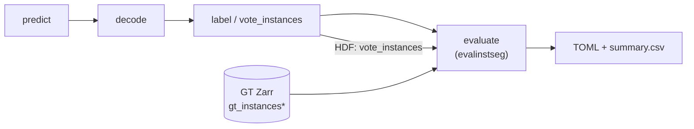
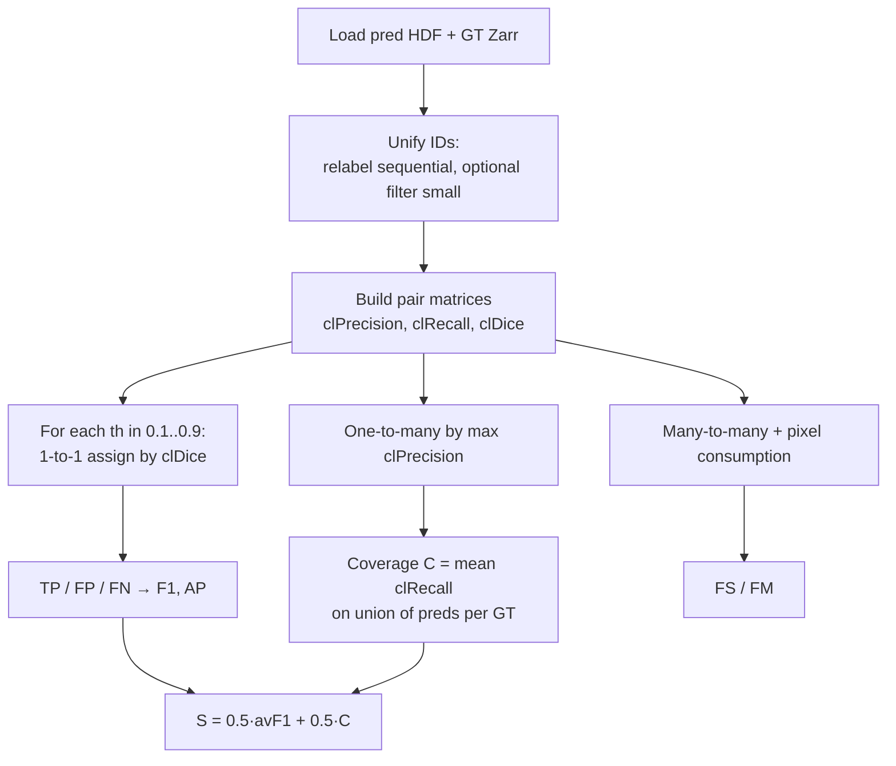
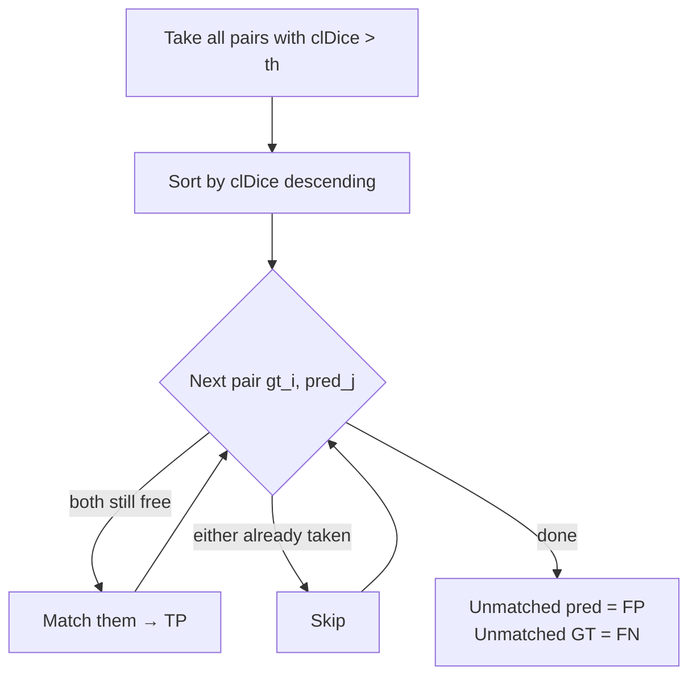
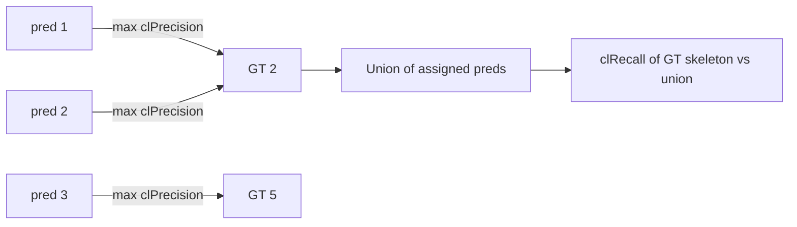
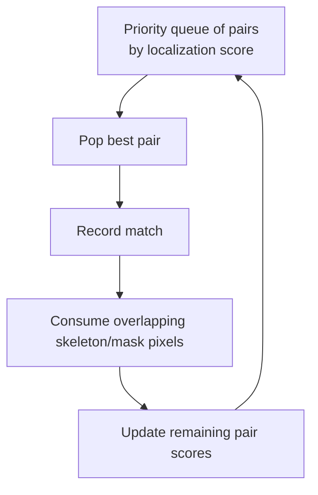

> **Historical / archived.** Current PatchPerPix ops and canonical presets: [`ppp_overview.md`](../ppp_overview.md). Keep this file for background only; do not treat recipes here as the live path.
>
> ---

# PatchPerPix / FISBe Evaluation Guide

How predicted instance labels are matched to ground-truth instances and turned into metrics.

PPP does **not** implement evaluation itself. The `evaluate` stage in `run_ppp.py` calls the FISBe package [`evaluate-instance-segmentation`](../../../evaluate-instance-segmentation/) (`evalinstseg`).

---

## 1. Pipeline context



| Step | What | Where |
|------|------|-------|
| predict | Affinities / patches / numinst | `processed/` |
| decode | Decode patches → affinities | |
| label | Graph assembly → instance IDs | `instanced/.../*.hdf` key `vote_instances` |
| evaluate | Match pred ↔ GT, score | `evaluated/.../*.toml` |

Config (typical FlyLight TOML):

```toml
[evaluation]
res_key = "vote_instances"
localization_criterion = "cldice"
assignment_strategy = "greedy"   # NOT hungarian for official PPP runs
remove_small_components = 500
metric = "general.avg_f1_cov_score"
add_general_metrics = ["avg_gt_skel_coverage", "avg_f1_cov_score", "false_merge", "false_split"]
```

Call site: `PatchPerPix/experiments/run_ppp.py` → `evaluate_file(...)`.

---

## 2. End-to-end evaluation algorithm



### 2.1 Preprocess IDs (`check_fix_and_unify_ids`)

1. Optionally drop predicted components with size `< remove_small_components` (PPP default: 500).
2. Relabel pred and GT to sequential IDs starting at 1 (0 = background).
3. Multi-channel binary masks get unique IDs per channel.

**Important:** Matching is by **spatial overlap / clDice**, not by raw ID equality. Pred ID 7 matching GT ID 3 is normal.

### 2.2 Localization matrices (`localize.py`)

For every pair `(gt_i, pred_j)` (plus background row/col 0):

| Matrix | Meaning |
|--------|---------|
| `precMat[i,j]` | **clPrecision**: fraction of *pred* skeleton inside *gt* mask |
| `recallMat[i,j]` | **clRecall**: fraction of *gt* skeleton covered by *pred* mask |
| `locMat[i,j]` | **clDice** $= 2 \cdot P \cdot R / (P + R)$ |

clDice is used because thin neurons make voxel IoU unstable under small boundary shifts.

```text
clPrecision:  skeletonize(pred_j) → what fraction lands in gt_i?
clRecall:     skeletonize(gt_i)   → what fraction lands in pred_j?
clDice:       harmonic mean of those two
```

---

## 3. Matching strategies (three different jobs)

### Q: Is it the Hungarian algorithm?

**Implemented:** yes (`scipy.optimize.linear_sum_assignment` in `match.assign_labels`).
**Used by PPP FlyLight configs / FISBe official protocol for avF1:** **no — greedy.**

| Metric family | Strategy | Hungarian? |
|---------------|----------|------------|
| avF1, TP/FP/FN, precision/recall | Greedy **1-to-1** on clDice | No (default PPP) |
| Coverage *C* | **One-to-many** (each pred → GT with max clPrecision) | No |
| FS / FM | Greedy **many-to-many** with pixel consumption | No |

Hungarian is available (`assignment_strategy = "hungarian"` or legacy `use_linear_sum_assignment = true`). Function default in `evaluate_volume` is `"hungarian"`, but PPP TOMLs override to `"greedy"`.

---

### 3.1 Greedy 1-to-1 (avF1 / detection metrics)

Code: `assign_labels(..., assignment_strategy="greedy")`.



Properties:
- Each GT matched to **at most one** pred, and vice versa.
- Highest-scoring pairs win first (locally greedy; not globally optimal like Hungarian).
- Repeated independently for each threshold $th \in \{0.1, \ldots, 0.9\}$.

At threshold $th$:

$$
\begin{aligned}
TP &= \text{number of matched pairs with clDice} > th \\
FP &= N_{\mathrm{pred}} - TP \\
FN &= N_{\mathrm{GT}} - TP \\
F1 &= \frac{2\,TP}{2\,TP + FP + FN}
\end{aligned}
$$

$$
\mathrm{avF1} = \mathrm{mean}_{th=0.1}^{0.9} F1(th)
$$

(stored as `confusion_matrix.avFscore19`)

---

### 3.2 Hungarian variant (optional, not PPP default)

```python
costs = -(locFgMat > thresh).astype(float) - locFgMat / (2 * num_matches)
gt_ind, pred_ind = linear_sum_assignment(costs)
# keep only pairs with locMat > thresh as TP
```

Minimizes assignment cost via the Hungarian algorithm (optimal bipartite matching). Cost prefers pairs above threshold, then higher clDice. After assignment, pairs with clDice ≤ thresh are discarded (not counted as TP).

Use when you want globally optimal 1-to-1 matching; FISBe leaderboard protocol uses **greedy**.

---

### 3.3 One-to-many for Coverage *C*

Code: `get_gt_coverage`.



1. For each pred, assign to the GT with **highest clPrecision** (a GT may get many preds).
2. For each GT, form the **union** of its assigned preds.
3. Score = clRecall of that GT vs the union (avoids double-counting overlapping preds).
4. $C =$ mean over all GT instances → `general.avg_gt_skel_coverage`.

Official ranking score:

$$
S = 0.5 \cdot \mathrm{avF1} + 0.5 \cdot C
$$

→ `general.avg_f1_cov_score` (PPP’s primary `metric`).

---

### 3.4 Many-to-many for False Splits / False Merges

Code: `greedy_many_to_many_matching` + `get_m2m_metrics`.



After matches $M$:

$$
\begin{aligned}
FS &= \sum_{\mathrm{gt}} \max\bigl(0,\, n_{\mathrm{preds\,on\,gt}} - 1\bigr) \\
FM &= \sum_{\mathrm{pred}} \max\bigl(0,\, n_{\mathrm{GTs\,on\,pred}} - 1\bigr)
\end{aligned}
$$

Interpretation: extra preds on one GT → split; one pred covering multiple GTs → merge.

---

## 4. Worked mini-example

Suppose 3 GT, 4 pred; clDice matrix (fg only):

|        | P1  | P2  | P3  | P4  |
|--------|-----|-----|-----|-----|
| **G1** | 0.9 | 0.2 | 0.0 | 0.1 |
| **G2** | 0.3 | 0.8 | 0.7 | 0.0 |
| **G3** | 0.0 | 0.1 | 0.2 | 0.0 |

**Greedy at th=0.5:**

1. Best pair G1–P1 (0.9) → match
2. Next G2–P2 (0.8) → match
3. G2–P3 (0.7) skipped (G2 taken)
4. Nothing else > 0.5

→ TP=2, FP=2 (P3,P4), FN=1 (G3)

**Coverage:** each pred goes to argmax clPrecision GT; *C* averages clRecall of GT vs union of its preds (can credit fragmented coverage that F1’s 1-to-1 matching would not).

---

## 5. Partly-labeled mode

For sparse GT (`partly=True`): unmatched preds count as FP **only** if their best precision match is a foreground GT; preds over unlabeled background are ignored. Completely-labeled volumes use the standard $FP = N_{\mathrm{pred}} - TP$.

---

## 6. Code map

| Piece | File |
|-------|------|
| PPP wiring | `PatchPerPix/experiments/run_ppp.py` (`evaluate` → `evaluate_file`) |
| Volume eval loop | `evaluate-instance-segmentation/evalinstseg/evaluate.py` |
| clDice matrices | `evaluate-instance-segmentation/evalinstseg/localize.py` |
| Greedy / Hungarian assign | `evaluate-instance-segmentation/evalinstseg/match.py` → `assign_labels` |
| Coverage C | `evaluate-instance-segmentation/evalinstseg/compute.py` → `get_gt_coverage` |
| FS/FM | `evaluate-instance-segmentation/evalinstseg/match.py` + `compute.get_m2m_metrics` |
| Metric catalog | `evaluate-instance-segmentation/docs/METRICS.md` |

---

## 7. Quick answers

| Question | Answer |
|----------|--------|
| How are instances matched for F1? | Pairwise **clDice**, then **greedy 1-to-1** at each threshold |
| Hungarian? | Available; **not** used in PPP FlyLight TOMLs / official FISBe avF1 |
| How is coverage matched? | Each pred → GT with max **clPrecision**; score = **clRecall** on union |
| Primary PPP scalar | $S = 0.5\cdot\mathrm{avF1} + 0.5\cdot C$ → `general.avg_f1_cov_score` |
