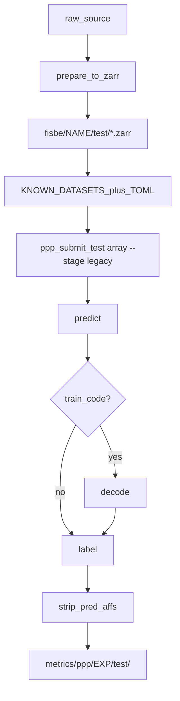

# Inference on a new dataset (e.g. himanshu)

Run PatchPerPix **predict → label** on a folder under `fisbe/` using an
already-trained checkpoint. Worked example: **himanshu** (split-line MCFO, test-only,
raw-only — no GT; dataset details in [`md_guides/dataset/himanshu.md`](../dataset/himanshu.md)).

For train/val datasets with GT (`completely`, `partly`, `synth_vh`), use the
prep path in [`ppp_overview.md`](ppp_overview.md) §2 (`prepare_fisbe_for_ppp`,
FG points, stage tars) and `--stage all` (includes evaluate). This guide is for
**inference-only** volumes.

Submit from the **repo root**. GPU work goes through
[`sbatch/ppp/ppp_submit_test.sh`](../../sbatch/ppp/ppp_submit_test.sh).

---

## Workflow



No GT → skip evaluate; do **not** pass `--agg`. Strip `pred_affs` manually after
instances exist (auto-strip only runs after evaluate).

---

## Data layout

List-mode infer expects:

| Requirement | Detail |
|-------------|--------|
| Path | `fisbe/<name>/test/<stem>.zarr` |
| Arrays | `volumes/raw` (u2) + `volumes/raw_normalized` (f4, e.g. clip / clipmax) |
| Sample IDs | Always `{dataset}/{stem}` (flat stems are rejected) |
| Optional | Root attrs `voxel_size_um` (web falls back per dataset if missing) |

No `train/` / `val/`, FG CSVs, or stage tars are needed for inference-only.

Himanshu writes this layout via
[`data_download_methods/prepare_himanshu_for_ppp.py`](../../data_download_methods/prepare_himanshu_for_ppp.py)
(sbatch: [`himanshu_sbatch.sh`](../../sbatch/ppp/prep/himanshu/himanshu_sbatch.sh)).

---

## Prepare data (himanshu)

One job downloads and converts
([`himanshu_sbatch.sh`](../../sbatch/ppp/prep/himanshu/himanshu_sbatch.sh)):

1. [`download_mcfo.py`](../../data_download_methods/download_mcfo.py) (host, aws CLI) picks each
   line's own MCFO `.h5j` from the FlyLight S3 bucket. Lines and per-line filters
   (`ss sex area slide_code`) are in
   [`himanshu_lines.tsv`](../../data_download_methods/himanshu_lines.tsv); the slide codes pin
   one fly per line with a 3-colour image at both 20x and 63x. It writes
   `downloads/mcfo_manifest_<objective>.tsv`.
2. `prepare_himanshu_for_ppp.py` (ppp container) converts every `selected` row to
   `fisbe/<NAME>/test/*.zarr` at the **native voxel size** (no resampling).

Default: `OBJECTIVE=20x` → `fisbe/himanshu_20x/test` (0.52 × 0.52 × 1.0 µm; SS47398
0.59 × 0.59 × 1.0 µm). Needs PyAV in the `ppp` overlay once:
`sbatch sbatch/ppp/env/ppp_env_install_av_sbatch.sh`.

```bash
DRY_RUN=1 sbatch sbatch/ppp/prep/himanshu/himanshu_sbatch.sh   # manifest only: picks + sizes
LIMIT=1   sbatch sbatch/ppp/prep/himanshu/himanshu_sbatch.sh   # smoke (1 stack)
sbatch sbatch/ppp/prep/himanshu/himanshu_sbatch.sh             # all 20 → fisbe/himanshu_20x/test
OBJECTIVE=63x NAME=himanshu sbatch ...                         # the 63x set (fisbe/himanshu)
CLEAN=1 sbatch ...                                             # wipe the output dir first
```

**Generic new source:** produce the same zarr contract under
`fisbe/<name>/test/`. You do not need `prepare_fisbe_for_ppp` unless you also
have GT instances to score.

### Optional: resample to the FISBe voxel size (himanshu → himanshu_r044)

PPP checkpoints are trained on FISBe, **0.44 µm isotropic** (FISBe paper §2.1).
Himanshu 63x stacks are 0.19 × 0.19 × 0.38 µm, so neurites look ~2.3× thicker in
XY and the volumes are ~6× larger than needed. The 63x set was resampled before inference
(20x is run at its native grid first):

```bash
sbatch sbatch/ppp/prep/himanshu/resample_himanshu_sbatch.sh      # LIMIT=1 for a smoke
```

[`resample_himanshu_zarr.py`](../../data_download_methods/resample_himanshu_zarr.py)
reads `fisbe/himanshu/test/*.zarr` (read-only) and writes
`fisbe/himanshu_r044/test/*.zarr`: per channel `skimage.transform.resize(order=1,
anti_aliasing=True)`, then `write_zarr()` from the prep script (same chunks /
clipmax / float16 `raw_normalized`). Root attrs: `voxel_size_um = [0.44]*3`,
`effective_voxel_size_um`, `source_voxel_size_um`, `source_shape`, `resampled_from`.
Existing outputs are skipped (delete a `.zarr` by hand to redo it).
`himanshu_r044` is registered in `KNOWN_DATASETS`; its overlay is
`datasets_test_himanshu_r044.toml` (no `max_test_samples`, all volumes).

Note: `[evaluation] remove_small_components` (rm200 / rm1500) is a voxel count at
the FISBe scale; it only carries over unchanged to data at 0.44 µm. A native 20x voxel
(0.52 × 0.52 × 1.0 µm) is ~3.2× a FISBe voxel, so rm1500 there removes ~3× more volume.

---

## PPP configs and registration

Checklist for a new dataset name `<name>`:

| Piece | What to do |
|-------|------------|
| Overlay TOML | Copy [`datasets_test_himanshu_20x.toml`](../../PatchPerPix/experiments/flylight/setups/setup01/configs/data/datasets_test_himanshu_20x.toml): set `test_datasets = ["<name>"]`, optional `max_test_samples` |
| `--datasets` + `--config` | Must match. `--datasets` sizes / indexes the SLURM array; the TOML drives `run_ppp` |
| `KNOWN_DATASETS` | Add `"<name>"` to the frozenset in [`run_ppp.py`](../../PatchPerPix/experiments/run_ppp.py) |
| Web / sample lists (optional) | `sample_list_per_split.txt`, [`web/server/services/sample_list.py`](../../web/server/services/sample_list.py), cleanup allowlists — only if you browse in the web app |

Himanshu overlay (reference):

```toml
[data]
test_datasets = ["himanshu_20x"]
# max_test_samples = 5   # optional: first N sorted volumes only
```

Do not change train configs. Point `--id` / `--ckpt` at an existing trained
experiment.

---

## Run inference

Verify how many volumes the array will see (honors `max_test_samples`):

```bash
python3 sbatch/ppp/ppp_datasets.py --split test --count --datasets himanshu_20x \
  original_default.toml datasets_test_himanshu_20x.toml
```

Submit (predict[+decode]+label; **no** evaluate):

```bash
./sbatch/ppp/ppp_submit_test.sh array <preset> \
  --base original_default.toml \
  --id <trained_exp> \
  --split test \
  --ckpt <N> \
  --datasets himanshu_20x \
  --config datasets_test_himanshu_20x.toml \
  --stage legacy
```

Example with a current preset:

```bash
./sbatch/ppp/ppp_submit_test.sh array our-noenc-cs \
  --base original_default.toml \
  --id our-noenc-cs \
  --split test \
  --ckpt 400000 \
  --datasets himanshu_20x \
  --config datasets_test_himanshu_20x.toml \
  --stage legacy
```

| Flag | Why |
|------|-----|
| `--datasets himanshu_20x` | Array sample list under `fisbe/himanshu_20x/test/` (presets default to `completely` / etc.) |
| `--config datasets_test_himanshu_20x.toml` | Sets `test_datasets` (+ optional `max_test_samples`) for `run_ppp` |
| `--stage legacy` | One GPU job: `predict[+decode]+label`. Omit `--agg` — evaluate needs GT |
| `--base original_default_train_code.toml` | Use this instead when the preset has `train_code=true` (legacy still inserts decode) |

Add `--dry-run` to print sbatch lines without submitting.

Do **not** use `--stage all|label` without `--no-eval` (or `--agg`) without GT —
those chain evaluate.

### Preferred: split pipeline without evaluate (`--no-eval`)

`--stage legacy` labels on the GPU node, so the GPU idles during the CPU label
phase (low-utilization cancels on public partitions). `--stage all --no-eval`
runs GPU predict → GPU label graph → CPU label (per-volume `aftercorr`) and
chains no evaluate. Run it in its own exp dir: copy the checkpoint +
`train_net_config.json` / `test_net_config.json` into `metrics/ppp/<new_exp>/train/`,
because `run_ppp` rewrites the `config.toml` of whichever exp dir it runs in.

Himanshu 20x (current; no small-instance filter, see
[`md_guides/dataset/himanshu.md`](../dataset/himanshu.md)):

```bash
./sbatch/ppp/ppp_submit_test.sh array our-noenc-c1k_v1.1 \
  --id himanshu20x-e1.3 --split test --ckpt 23000 --base original_default.toml \
  --config expv2_e1_common.toml --config expv2_e1_ft.toml \
  --config expv2_e1_ft_expv2-e1.3-ft-n1000-completely.toml --config pred_sparse_affs.toml \
  --datasets himanshu_20x --config datasets_test_himanshu_20x.toml \
  --stage all --no-eval --pct 10 --account torch_pr_61_tandon_priority
```

Earlier worked example (2026-11-17, himanshu_r044 with EXP 1.3 @ 23000, exp dir
`himanshu-e1.3-rm1500`; it also ran the rm1500 filter below):

```bash
./sbatch/ppp/ppp_submit_test.sh array our-noenc-c1k_v1.1 \
  --id himanshu-e1.3-rm1500 --split test --ckpt 23000 --base original_default.toml \
  --config expv2_e1_common.toml --config expv2_e1_ft.toml \
  --config expv2_e1_ft_expv2-e1.3-ft-n1000-completely.toml --config pred_sparse_affs.toml \
  --datasets himanshu_r044 --config datasets_test_himanshu_r044.toml \
  --stage all --no-eval --pct 10 --account torch_pr_61_tandon_priority
```

## Small-instance filter without evaluate (rm1500 etc.)

**Not used for Himanshu** (decision 2026-11-17): Himanshu inference keeps the raw
`vote_instances`. Only PPP's label-stage `[vote_instances] ignore_small_comps = 200`
(in `original_default.toml`, applies to every dataset) is in effect.

`remove_small_components` from `eval_rm*.toml` is applied only inside evaluate
(`evalinstseg.util.filter_components`: drop labels with ≤ N voxels). For no-GT runs
apply the same rule with
[`filter_small_instances.py`](../../sbatch/ppp/tools/filter_small_instances.py),
which adds `vote_instances_rm<N>` (relabelled 1..K) next to the untouched
`vote_instances` in each `.hdf` and writes `<inst-root>/<dataset>_rm<N>_summary.csv`:

```bash
python sbatch/ppp/tools/filter_small_instances.py \
  --inst-root metrics/ppp/himanshu-e1.3-rm1500/test/instanced/23000 \
  --dataset himanshu_r044 --rm 1500
```

Checked against evaluate: on EXP 1.3's completely labels it gives the same
instance counts as evaluate's `Num Pred` at rm1500 (16 and 15).

---

## After instances: strip `pred_affs`

`ppp_job.sh` strips large prediction arrays only after `-d evaluate`. For
legacy / no-GT runs, clean up manually:

```bash
python3 sbatch/ppp/strip_pred_affs.py \
  --root metrics/ppp --exp <exp_id> --split test --ckpt <N> --dry-run

python3 sbatch/ppp/strip_pred_affs.py \
  --root metrics/ppp --exp <exp_id> --split test --ckpt <N> \
  --arrays volumes/pred_affs
```

Default also strips `volumes/pred_code` if present. `pred_numinst` is kept.
See [`strip_pred_affs.py`](../../sbatch/ppp/strip_pred_affs.py).

---

## Outputs and pitfalls

- **Outputs:** `metrics/ppp/<exp_id>/test/{processed,instanced}/…`
- **`max_test_samples`:** truncates sorted discovery (first N of whatever is on
  disk). The himanshu overlays leave it unset (all volumes).
- **No evaluate / `--agg`** without `gt_instances`.
- Submit from the repo root; never run GPU PPP on a login node outside the
  singularity + `ppp` overlay path used by `ppp_submit_test.sh`.
