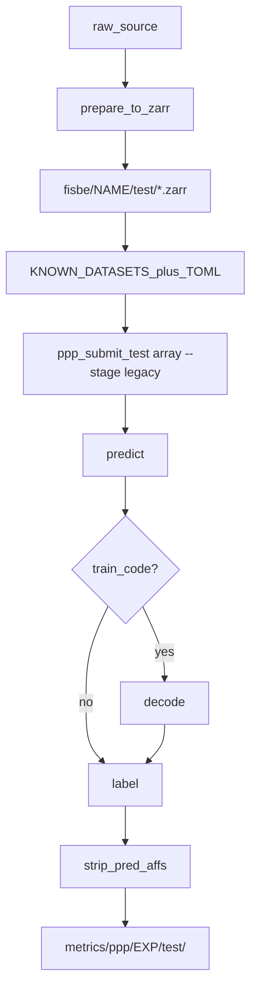

# Inference on a new dataset (e.g. himanshu)

Run PatchPerPix **predict → label** on a folder under `fisbe/` using an
already-trained checkpoint. Worked example: **himanshu** (Gen1 MCFO, test-only,
raw-only — no GT).

For train/val datasets with GT (`completely`, `partly`, `synth_vh`), use the
prep path in [`ppp_overview.md`](ppp_overview.md) §2 (`prepare_fisbe_for_ppp`,
FG points, stage tars) and `--stage all` (includes evaluate). This guide is for
**inference-only** volumes.

Submit from the **repo root**. GPU work goes through
[`sbatch/ppp/ppp_submit_test.sh`](../../sbatch/ppp/ppp_submit_test.sh).

---

## Workflow



No GT → skip evaluate; do **not** pass `--agg`. Strip `pred_affs` manually after
instances exist (auto-strip only runs after evaluate).

---

## Data layout

List-mode infer expects:

| Requirement | Detail |
|-------------|--------|
| Path | `fisbe/<name>/test/<stem>.zarr` |
| Arrays | `volumes/raw` (u2) + `volumes/raw_normalized` (f4, e.g. clip / clipmax) |
| Sample IDs | Always `{dataset}/{stem}` (flat stems are rejected) |
| Optional | Root attrs `voxel_size_um` (web falls back per dataset if missing) |

No `train/` / `val/`, FG CSVs, or stage tars are needed for inference-only.

Himanshu writes this layout via
[`data_download_methods/prepare_himanshu_for_ppp.py`](../../data_download_methods/prepare_himanshu_for_ppp.py)
(sbatch: [`prepare_himanshu_for_ppp_sbatch.sh`](../../sbatch/ppp/prep/himanshu/prepare_himanshu_for_ppp_sbatch.sh)).

---

## Prepare data (himanshu)

**Prereqs**

1. `downloads/hemidrivers.tsv` + Gen1 MCFO stacks
   (`sbatch/data/s3_download_{meta,gen1}_sbatch.sh`)
2. PyAV in the `ppp` overlay:
   `sbatch sbatch/ppp/env/ppp_env_install_av_sbatch.sh`

**Commands** (repo root):

```bash
# Smoke (one stack)
LIMIT=1 sbatch sbatch/ppp/prep/himanshu/prepare_himanshu_for_ppp_sbatch.sh

# Full convert → fisbe/himanshu/test/*.zarr
sbatch sbatch/ppp/prep/himanshu/prepare_himanshu_for_ppp_sbatch.sh

# Regenerate (delete then prep)
DEL_JID=$(sbatch --parsable sbatch/ppp/prep/himanshu/delete_himanshu_zarrs_sbatch.sh)
sbatch --dependency=afterok:$DEL_JID \
  sbatch/ppp/prep/himanshu/prepare_himanshu_for_ppp_sbatch.sh
```

**Generic new source:** produce the same zarr contract under
`fisbe/<name>/test/`. You do not need `prepare_fisbe_for_ppp` unless you also
have GT instances to score.

---

## PPP configs and registration

Checklist for a new dataset name `<name>`:

| Piece | What to do |
|-------|------------|
| Overlay TOML | Copy [`datasets_test_himanshu.toml`](../../PatchPerPix/experiments/flylight/setups/setup01/datasets_test_himanshu.toml): set `test_datasets = ["<name>"]`, optional `max_test_samples` |
| `--datasets` + `--config` | Must match. `--datasets` sizes / indexes the SLURM array; the TOML drives `run_ppp` |
| `KNOWN_DATASETS` | Add `"<name>"` to the frozenset in [`run_ppp.py`](../../PatchPerPix/experiments/run_ppp.py) |
| Web / sample lists (optional) | `sample_list_per_split.txt`, [`web/server/services/sample_list.py`](../../web/server/services/sample_list.py), cleanup allowlists — only if you browse in the web app |

Himanshu overlay (reference):

```toml
[data]
test_datasets = ["himanshu"]
max_test_samples = 5
```

Do not change train configs. Point `--id` / `--ckpt` at an existing trained
experiment.

---

## Run inference

Verify how many volumes the array will see (honors `max_test_samples`):

```bash
python3 sbatch/ppp/ppp_datasets.py --split test --count --datasets himanshu \
  original_default.toml datasets_test_himanshu.toml
```

Submit (predict[+decode]+label; **no** evaluate):

```bash
./sbatch/ppp/ppp_submit_test.sh array <preset> \
  --base original_default.toml \
  --id <trained_exp> \
  --split test \
  --ckpt <N> \
  --datasets himanshu \
  --config datasets_test_himanshu.toml \
  --stage legacy
```

Example with a current preset:

```bash
./sbatch/ppp/ppp_submit_test.sh array our-noenc-cs \
  --base original_default.toml \
  --id our-noenc-cs \
  --split test \
  --ckpt 400000 \
  --datasets himanshu \
  --config datasets_test_himanshu.toml \
  --stage legacy
```

| Flag | Why |
|------|-----|
| `--datasets himanshu` | Array sample list under `fisbe/himanshu/test/` (presets default to `completely` / etc.) |
| `--config datasets_test_himanshu.toml` | Sets `test_datasets` + `max_test_samples` for `run_ppp` |
| `--stage legacy` | One GPU job: `predict[+decode]+label`. Omit `--agg` — evaluate needs GT |
| `--base original_default_train_code.toml` | Use this instead when the preset has `train_code=true` (legacy still inserts decode) |

Add `--dry-run` to print sbatch lines without submitting.

Do **not** use `--stage all` (or `--agg`) without GT — those chain evaluate.

---

## After instances: strip `pred_affs`

`ppp_job.sh` strips large prediction arrays only after `-d evaluate`. For
legacy / no-GT runs, clean up manually:

```bash
python3 sbatch/ppp/strip_pred_affs.py \
  --root metrics/ppp --exp <exp_id> --split test --ckpt <N> --dry-run

python3 sbatch/ppp/strip_pred_affs.py \
  --root metrics/ppp --exp <exp_id> --split test --ckpt <N> \
  --arrays volumes/pred_affs
```

Default also strips `volumes/pred_code` if present. `pred_numinst` is kept.
See [`strip_pred_affs.py`](../../sbatch/ppp/strip_pred_affs.py).

---

## Outputs and pitfalls

- **Outputs:** `metrics/ppp/<exp_id>/test/{processed,instanced}/…`
- **`max_test_samples`:** truncates sorted discovery (himanshu overlay = 5 of
  whatever is on disk). Raise or remove it in the overlay for a full run.
- **No evaluate / `--agg`** without `gt_instances`.
- Submit from the repo root; never run GPU PPP on a login node outside the
  singularity + `ppp` overlay path used by `ppp_submit_test.sh`.
