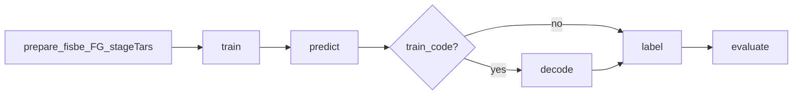

# PatchPerPix overview (current)

Ops and canonical presets for FISBe PatchPerPix on NYU Greene.
Architecture spine: [`PatchPerPix/CODEBASE.md`](../../PatchPerPix/CODEBASE.md).
Launchers: [`sbatch/ppp/ppp_submit_train.sh`](../../sbatch/ppp/ppp_submit_train.sh) and
[`ppp_submit_test.sh`](../../sbatch/ppp/ppp_submit_test.sh) →
[`ppp_job.sh`](../../sbatch/ppp/ppp_job.sh).

Older guides live under [`historical/`](historical/) (see [Archived guides](#archived-guides)).

Submit from the **repo root** (`/scratch/wmz2007/neuroinfo_fruitfly`).

---

## 1. Pipeline

Learning (PyTorch / gunpowder) and assembly (CUDA vote_instances) talk **only
through Zarr/HDF on disk**. One entry point: `PatchPerPix/experiments/run_ppp.py`
with `-d` tasks:

```text
train → predict → [decode if train_code] → label → evaluate
```

| Stage | Output |
|-------|--------|
| predict | Affinities / patches / numinst under `processed/` |
| decode | Patches → affinities (only when `train_code=true`) |
| label | Instance IDs in `instanced/.../*.hdf` key `vote_instances` |
| evaluate | `evalinstseg` → TOML + `summary.csv` under `evaluated/` |



Array `--stage all` (default) splits label for queue efficiency:

```mermaid
flowchart LR
  pred[GPU_predict] --> dec{train_code?}
  dec -->|yes| decode[GPU_decode]
  dec -->|no| graph[GPU_labgraph]
  decode --> graph
  graph --> cpuLabel[CPU_label]
  cpuLabel --> eval[CPU_evaluate]
```

### Test split

One array task per volume. For a preset with `train_code = false` (for example
`our-noenc-synth_vh_u8`) there is no decode step. From the repo root:

```bash
./sbatch/ppp/ppp_submit_test.sh array our-noenc-synth_vh_u8 --ckpt 26000 --split test
```

`--stage all` (the default) runs these steps in order. Paths below use that
experiment and checkpoint; other presets land under `metrics/ppp/<exp_id>/`.

1. **Predict (GPU).** The checkpoint is run on each test volume. Affinities and
   the instance-count prediction are written to
   `metrics/ppp/<exp_id>/test/processed/<ckpt>/<dataset>/<sample>.zarr`.
2. **Patch graph (GPU, job name `labgraph`).** Blockwise vote-instances builds
   the per-block and inter-block patch graph (`vi_split_gpu.toml`,
   `termAfterStitchGraph`). The graph is cached in
   `test/instanced/<ckpt>/.../<sample>.zarr` under `volumes/blocks`. The task
   sets `stitch_graph_done` and stops before assigning instance ids, so the GPU
   is not held for the CPU work. A later retry skips blocks that already have
   both `patch_pairs` and `aff_graph_mat`. Walltime is 4 hours.
3. **Label (CPU).** `vi_split_cpu.toml` reads that graph and runs
   `affGraphToInstances` with no GPU. Task i waits only for GPU task i
   (`aftercorr`). It refuses to start if `stitch_graph_done` is missing. The
   instance volume is `test/instanced/<ckpt>/.../<sample>.hdf` (key
   `vote_instances`). Samples that already have a valid HDF are skipped when
   resume is on (`label_resume.toml`).
4. **Evaluate (CPU).** After every label task in the array succeeds, one job
   scores the HDFs against ground truth (`eval_rm200.toml` drops components
   smaller than 200 voxels). Per-sample log lines are
   `general.avg_f1_cov_score`. The table is
   `test/evaluated/<ckpt>/patch_threshold_0_3/fc_threshold_0_3/mws_True/skeletonize_foreground_True/numinst_threshs__0_9_0_1_/summary.csv`,
   also copied to `summary_test.csv`. Volumes with no HDF are omitted. The
   evaluate job then strips `volumes/pred_affs` and `volumes/pred_code` from the
   prediction Zarrs (`pred_numinst` is kept).

Stages can be submitted alone: `--stage predict`, `--stage label` (steps 2 and
3), or `./sbatch/ppp/ppp_submit_test.sh evaluate <preset> --split test --ckpt <N>`.
`--datasets completely` limits the array to `fisbe/completely/test` when the
preset TOML also lists a synth test set.

---

## 2. Data prep

Datasets live under `fisbe/<name>/{train,val,test}/` (Zarr). Canonical names used
by live presets: `completely`, `partly`, `synth_vh`.

Script-by-script prep reference: [`ppp_prep.md`](ppp_prep.md).
Inference-only / new dataset (e.g. himanshu): see
[`ppp_new_dataset_inference.md`](ppp_new_dataset_inference.md).

One-time / when a dataset changes:

```bash
# PPP arrays into each .zarr (raw_normalized, gt_instances_rm_5, …)
DATASETS=completely,partly,synth_vh sbatch sbatch/ppp/prep/prepare_fisbe_for_ppp_sbatch.sh

# FG point CSVs (needed when sample_fg_points=true)
SPLITS=completely/train,completely/val,completely/test \
  sbatch sbatch/ppp/prep/prepare_fg_points_sbatch.sh

# Stage tars for train jobs (STAGE_DATA=1 → $SLURM_TMPDIR)
DATASETS=completely,partly,synth_vh sbatch sbatch/ppp/prep/prepare_ppp_stage_tars_sbatch.sh
```

Scripts: `prepare_fisbe_for_ppp.py`, `prepare_fg_points_csv.py`,
`prepare_ppp_stage_tars.py` under `PatchPerPix/experiments/flylight/`.

---

## 3. How to launch

Train and inference are separate commands. Both set SLURM resources and call
[`ppp_job.sh`](../../sbatch/ppp/ppp_job.sh). Presets and the `sbatch` wrapper
live in `ppp_submit_common.sh`. `ppp_submit.sh` only prints the two commands
and exits. Add `--dry-run` to print the `sbatch` line without submitting.
`--help` on either script lists every flag.

```bash
./sbatch/ppp/ppp_submit_train.sh [--dry-run] <preset> [flags…]
./sbatch/ppp/ppp_submit_test.sh [--dry-run] <mode> <preset> [flags…]
```

Logs: `sbatch/ppp/logs/<job_name>-<jobid>.{out,err}`. Array tasks:
`sbatch/ppp/logs/array/<preset>_<split>_<arrayjob>_<task>.{out,err}`.

### Train

One GPU job. It unpacks `fisbe/<dataset>/{train,val}_ppp.tar` into
`$SLURM_TMPDIR` (`STAGE_DATA=1`) and runs `-d train`. CPU count, memory,
walltime, and partition come from the preset unless you override them.

```bash
./sbatch/ppp/ppp_submit_train.sh our-noenc-cs \
  --base original_default.toml --id our-noenc-cs --time 24:00:00
```

Flags you set in practice: `--base`, `--id`, `--config` (repeatable),
`--datasets`, `--time`, `--partition`, `--cpus`, `--mem`, `--account`,
`--dependency`. Canonical `--base` values are in [§4](#4-canonical-presets).

### Test

| Mode | When to use it |
|------|----------------|
| `array` | A whole val or test split. Default `--stage all`: GPU predict → [GPU decode if `train_code`] → GPU patch graph → CPU label → CPU evaluate. |
| `run` | One sample: predict[+decode]+label+evaluate. |
| `evaluate` | CPU rescore. `--split val` or `--split test` scores that split. Omit `--split`, or pass `val,test`, to score both and write a merged `summary.csv`. |
| `ckpt-sweep` | Each checkpoint: predict → [decode] → label+evaluate. Skips a checkpoint whose prediction Zarr is already complete. |
| `vi-sweep` | One sample, chained across VI overlays (`vi_th_0_3` … `vi_th_0_7` unless `--overlays` is set). |

```bash
./sbatch/ppp/ppp_submit_test.sh array our-noenc-cs \
  --base original_default.toml --ckpt 400000 --split test

./sbatch/ppp/ppp_submit_test.sh run base1-noenc-c \
  --base original_default.toml --ckpt 400000 \
  --sample completely/R22C03-20180918_66_J2 --split val
```

Submit one array stage with `--stage predict`, `--stage decode` (only when
`train_code` is set), `--stage label` (GPU graph, then CPU label), or
`--stage legacy` (predict[+decode]+label on one GPU). `--agg` chains evaluate
after `--stage legacy`. `array` and `--stage label` already chain evaluate.
`--pct` is array concurrency (default 2).

Wait for a training job by passing the id that `ppp_submit_train.sh` prints:

```bash
./sbatch/ppp/ppp_submit_test.sh array <preset> --ckpt N --dependency <train_job_id>
```

Other flags: `--datasets`, `--vi` (default `vi_th_0_3.toml`), `--eval` (default
`eval_rm200.toml`), `--do` (override `-d` tasks for `run`), `--keep-pred-affs`,
`--keep-pred-code`, plus the same resource flags as train.

**Sample IDs:** always `{dataset}/{stem}` (e.g. `completely/R22C03-20180918_66_J2`).
Flat stems are rejected.

**Outputs:**

```text
metrics/ppp/<exp_id>/
  config.toml
  run.log                    # train / no --sample
  log/<dataset>/<stem>/run.log
  train/
  val/{processed,instanced,evaluated}/…
  test/{processed,instanced,evaluated}/…
```

Infer and array jobs omit `--test-data`, so the TOML `*_datasets` lists stay
active. Pass `--split val|test`. Optional `--datasets A,B` overrides those
lists for that job; `run_ppp` errors if a listed directory is missing.

### Python helpers

These sit next to the submitters. A normal train or test command calls them
itself. Run one by hand only for the checks below.

| Script | What it does in the pipeline |
|--------|------------------------------|
| [`needs_decode.py`](../../sbatch/ppp/needs_decode.py) | Prints `1` when the merged TOMLs set `training.train_code`. Both submitters export that as `NEEDS_DECODE`, which inserts the decode stage. |
| [`ppp_datasets.py`](../../sbatch/ppp/ppp_datasets.py) | Dataset names and `{dataset}/{stem}` lists from the merged TOMLs. Sizes the SLURM array and tells `ppp_job.sh` which `fisbe/` folders to read. |
| [`check_prediction_complete.py`](../../sbatch/ppp/check_prediction_complete.py) | A prediction counts as finished only when every chunk is on disk. Array predict drops incomplete volumes; label-only and decode-only jobs refuse to start on them; `ckpt-sweep` skips finished checkpoints. |
| [`merge_ppp_summary_csvs.py`](../../sbatch/ppp/merge_ppp_summary_csvs.py) | After evaluate of both splits, concatenates `summary_val.csv` and `summary_test.csv` and recomputes the mean and sum rows. |
| [`strip_pred_affs.py`](../../sbatch/ppp/strip_pred_affs.py) | After evaluate, deletes `volumes/pred_affs` and `volumes/pred_code`. Keeps `pred_numinst` and two named keep-samples. `--keep-pred-affs` and `--keep-pred-code` opt out. |

Count volumes before an array, or strip by hand when evaluate never ran (no GT):

```bash
python3 sbatch/ppp/ppp_datasets.py --split test --count --datasets himanshu \
  original_default.toml datasets_test_himanshu.toml

python3 sbatch/ppp/strip_pred_affs.py \
  --root metrics/ppp --exp <exp_id> --split test --ckpt <N> --dry-run
```

No-GT inference is written up in
[`ppp_new_dataset_inference.md`](ppp_new_dataset_inference.md).

---

## 4. Canonical presets

Always pass `--base` explicitly. The submitter default (`default_l40s.toml`) is
**not** the canonical base.

| Preset | `--base` | Datasets (train / val+test) | Notes |
|--------|----------|-----------------------------|-------|
| `our-noenc-cs` | `original_default.toml` | `synth_vh` / `completely`+`synth_vh` | noenc; FG points; fmaps24; 400k |
| `base1-noenc-c` | `original_default.toml` | `completely` / `completely` | noenc; FG points; fmaps24 |
| `basic-ppp-noenc-cp` | `original_default.toml` | `completely`+`partly` / same | noenc; FG points; fmaps24; 400k |
| `basic-ppp-decoder` | `original_default_train_code.toml` | `completely` / `completely` | `train_code=true` → **decode** in array; fmaps24; 400k |

Overlays live under
`PatchPerPix/experiments/flylight/setups/setup01/<preset>.toml`.

```bash
# Train examples
./sbatch/ppp/ppp_submit_train.sh our-noenc-cs \
  --base original_default.toml --id our-noenc-cs --time 24:00:00

./sbatch/ppp/ppp_submit_train.sh base1-noenc-c \
  --base original_default.toml --id base1-noenc-c --time 24:00:00

./sbatch/ppp/ppp_submit_train.sh basic-ppp-noenc-cp \
  --base original_default.toml --id basic-ppp-noenc-cp

./sbatch/ppp/ppp_submit_train.sh basic-ppp-decoder \
  --base original_default_train_code.toml --id basic-ppp-decoder --time 24:00:00

# Full val array at a checkpoint (decoder inserts decode automatically)
./sbatch/ppp/ppp_submit_test.sh array our-noenc-cs \
  --base original_default.toml --ckpt 400000 --split val

# One-sample smoke
./sbatch/ppp/ppp_submit_test.sh run base1-noenc-c \
  --base original_default.toml --ckpt 400000 \
  --sample completely/R22C03-20180918_66_J2 --split val
```

Default VI overlay: `vi_th_0_3.toml`. Default eval overlay: `eval_rm200.toml`.

Other presets remain in `PRESET_TABLE` for legacy jobs; do not treat them as the
live path.

---

## 5. Config merge

Layered left → right (later wins):

1. `--base` (`original_default.toml` or `original_default_train_code.toml`)
2. Preset overlay (`<preset>.toml`)
3. Optional `--config FILE.toml` (repeatable)
4. `--vi` / `--eval` overlays on infer/array/eval
5. CLI flags from `run_ppp.py` / `ppp_job.sh` (`--split`, `--fisbe-root` in list mode, …)

Deep per-key dictionary: archived [`ppp_config_defaults.md`](historical/ppp_config_defaults.md)
(written against an older defaults file; use CODEBASE + the live TOMLs as truth for
values).

---

## 6. Evaluation protocol

PPP does not score itself — `evaluate` calls
[`evaluate-instance-segmentation`](../../evaluate-instance-segmentation/)
(`evalinstseg`). Matching is by **clDice overlap**, not raw ID equality.
Assignment for official runs is **greedy**, not Hungarian.

| Symbol | Meaning |
|--------|---------|
| avF1 | Mean F1 over clDice thresholds after 1-to-1 assign |
| C | Mean clRecall coverage of GT by preds |
| S | \(0.5\cdot\mathrm{avF1}+0.5\cdot C\) |
| FS / FM | False split / false merge |
| skel cov | Skeleton coverage on matched pairs |

Size filters (do not confuse):

| Knob | Where | Role |
|------|-------|------|
| `vote_instances.ignore_small_comps` | stitch FG clean | Drop tiny FG comps before graph |
| `vote_instances.remove_small_comps` | post-label | Drop tiny instances in stitch |
| `evaluation.remove_small_components` | eval preprocess | Drop tiny preds **before** metrics |

While debugging instance quality, prefer a soft eval overlay (e.g. rm0/rm200) —
aggressive rm500 can hide over-fragmentation and inflate F1. Deep metric walkthrough:
archived [`ppp_evaluation.md`](historical/ppp_evaluation.md).

---

## 7. Train ops

- **Container:** `singularity exec --nv --overlay env/ppp.ext3:ro` + CUDA sif →
  `source /ext3/env.sh; conda activate ppp`. Pin `pycuda<=2024.1.2` in the overlay.
- **Staging:** train sets `STAGE_DATA=1` and unpacks `*_ppp.tar` into `$SLURM_TMPDIR`.
- **Prefetch:** `ThreadedPrefetch` after `gp.Stack`; TOML `prefetch_batches` (default 2).
  Fixes batch-handoff idle; more aug workers alone do not.
- **FG sampling:** when `sample_fg_points=true`, prepare FG CSVs first. Prefer that
  over integral-mask RandomLocation (long 0% GPU startup). `oversample_complete`
  multiplies mask-setup cost.
- **GPU util:** public partitions cancel low-util jobs. `ppp_job.sh` backgrounds
  `nvidia-smi … -l 1` into a CSV. Do not put `@fork` on train.
- **Workers / batch:** follow the preset TOML comments (L40S vs H200 CPU caps).
- **H200 (16 CPUs, bs 63):** the limit is handoff bytes (~35 MiB/sample through the
  PreCache pipe), not CPU count — L40S ran at ~2 busy cores. Use `raw_transport_fp16 = true`,
  ~12 workers, `cache_size ≈ 128`; benchmark with `sbatch/ppp/tools/bench_ppp_dataloader.py --raw-fp16`.
  Full write-up: [`ppp_h200_gpu_util.md`](ppp_h200_gpu_util.md).
- **Labgraph (GPU label phase):** consensus arrays live in device memory, kernels are
  cached, and pair code is vectorized, so blocks take ~3–7 s instead of ~2 min. Per-stage
  `time …` lines appear in the label `.out`.
  Full write-up: [`ppp_labgraph_speedup.md`](ppp_labgraph_speedup.md).

---

## 8. Quality strategy (timeless)

1. **Prediction quality first** — weak `pred_affs` / `pred_numinst` will not be
   fixed by VI merge knobs. Check mid-aff FG metrics and MIPs before long sweeps.
2. **Checkpoints** — `last` ≠ best; sweep or pick from val logs.
3. **VI overlays** — knob changes must appear in the validation product / zip path
   or they overwrite the baseline HDF. `DO_TASKS` in SLURM `--export` must use `+`
   not commas.
4. **Dead keys** — `do_nms`, `affinity_graph_voting*` are unused; changing them is a
   no-op.
5. **Report** Num Pred/GT, soft F1 / S, skel coverage, FS/FM, and a MIP — not a
   single F1 under a hard size filter.

---

## Archived guides

**Historical.** Background only under [`historical/`](historical/); recipes and
experiment IDs are not the live path. Current ops: this file.

| File | Was about |
|------|-----------|
| [`ppp_recommendations.md`](historical/ppp_recommendations.md) | Post-mortem after early smoke / long runs |
| [`ppp_performance_plan.md`](historical/ppp_performance_plan.md) | Layer A/B/C improvement plan |
| [`ppp_layer_a_prediction.md`](historical/ppp_layer_a_prediction.md) | Prediction-quality runbook (done) |
| [`ppp_layer_b_merge.md`](historical/ppp_layer_b_merge.md) | VI merge sweeps (closed) |
| [`ppp_list_mode_unify.md`](historical/ppp_list_mode_unify.md) | Val/test list-mode + multi-dataset (implemented) |
| [`ppp_gpu_util_prefetch.md`](historical/ppp_gpu_util_prefetch.md) | Prefetch / GPU util root-cause |
| [`ppp_sbatch_consolidation.md`](historical/ppp_sbatch_consolidation.md) | Submitter consolidation plan (implemented) |
| [`ppp_evaluation.md`](historical/ppp_evaluation.md) | Deep evalinstseg metric semantics |
| [`ppp_config_defaults.md`](historical/ppp_config_defaults.md) | Per-key TOML dictionary |
| [`ppp_train_sampling.md`](historical/ppp_train_sampling.md) | Crop sampling / FG points / startup |
