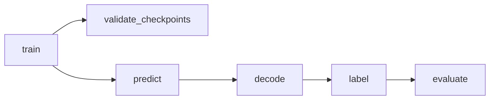

# PatchPerPix defaults config — parameter reference

Documents every key in the active defaults file:

[`PatchPerPix/experiments/flylight/setups/setup01/default_train_code_l40s.toml`](../PatchPerPix/experiments/flylight/setups/setup01/default_train_code_l40s.toml)

That file is the **ppp+dec** (`train_code=true`) L40s config cited in `CLAUDE.md` / `CODEBASE.md`. Sibling TOMLs share most keys:

| File | Difference (summary) |
|------|----------------------|
| `default_train_code.toml` | Same keys; smaller batch/workers/iters; local paths |
| `default_l40s.toml` | `train_code=false` (no autoencoder / code keys); longer train |
| `default.toml` | Original Janelia/direct-affinity setup; no FISBe-specific keys |

Architecture context: [`PatchPerPix/CODEBASE.md`](../PatchPerPix/CODEBASE.md).

---

## How configs are loaded

1. `run_ppp.py` accepts one or more `-c/--config` TOMLs and **deep-merges** them (`merge_dicts`).
2. CLI flags (`--train_data`, `--cuda`, `--blockwise`, …) override via `update_config`.
3. New runs write the merged config to `<exp>/config.toml`; resumes back up the previous copy under `backups/`.
4. Task runners unpack sections into flat kwargs for setup scripts:
   - **train** ← `data` + `model` + `training` + `optimizer` + `preprocessing`
   - **predict** ← `data` (minus GT `numinst_key`) + `model` + `preprocessing` + `prediction`
   - **decode** ← `model` + `prediction` + `visualize` + `data`
   - **label** ← `vote_instances` + `model` + `visualize` + selected `prediction` keys

Nested tables (`training.sampling`, `training.augmentation`, `model.autoencoder`) stay as dict values after unpack.

**Optimizer quirk:** TOML `[optimizer.optimizer]` becomes `config['optimizer'] = {optimizer: {optimizer, lr}}`. After `**config['optimizer']` into `train_until`, the train script sees `optimizer = {optimizer: "Adam", lr: …}`.

---

## Pipeline map (`-d` / `--do`)



| Task | Primary sections |
|------|------------------|
| `train` | `general`, `data`, `model`, `model.autoencoder`, `training*`, `optimizer` |
| `validate_checkpoints` | `validation` (+ overrides into `vote_instances` / `evaluation`) |
| `predict` | `data`, `model`, `prediction`, `general.overwrite` |
| `decode` | `model` (needs `train_code`), `prediction`, `visualize` |
| `label` | `vote_instances`, `model`, `prediction` keys, `visualize` |
| `evaluate` | `evaluation`, `data.gt_key`, `vote_instances` overlap flags |

High-impact semantics:

- **`model.train_code=true`** — network predicts a low-dim **code**; `decode` expands codes → affinities before labeling. If `false`, skip `decode` (direct affinities).
- **`model.overlapping_inst=true`** — **numinst** head (instance count per voxel) instead of binary fg/bg; required for crossing FlyLight neurons.
- **`training.add_affinities="loss"`** — GT affinities computed inside the loss (not in gunpowder); preferred for AMP/GPU.
- **`vote_instances.blockwise=true`** — `stitch_patch_graph` over chunks instead of loading the full volume.
- **`training.sampling.min_masked`** — after morphological opening of FISBe fg, `0.01` can starve crops; this defaults file uses `0.0001`.

---

## `[general]`

| Key | Default | Meaning | Consumed by |
|-----|---------|---------|-------------|
| `logging` | `"INFO"` | Python log level | `run_ppp.main` → `logging.basicConfig` |
| `debug` | `false` | Extra VI debug volumes; fail early on bad metrics | `mknet`, `evaluate_sample`, VI kwargs |
| `overwrite` | `false` | If false, skip existing predict/decode/label outputs. HPC stack uses `default_l40s.toml` (`overwrite = true`), so `ppp_submit.sh array` **rewrites** finished samples; incomplete `pred_affs` are discarded first (`DISCARD_PARTIAL` + `check_prediction_complete.py`). See [ppp_sbatch_consolidation.md](ppp_sbatch_consolidation.md) § “Array / re-run”. | `predict`, `decode`, `vote_instances_sample` |

---

## `[data]`

| Key | Default | Meaning | Consumed by |
|-----|---------|---------|-------------|
| `fisbe_root` | scratch `…/fisbe` | Dataset root | **Not read by `run_ppp`**. Prep script CLI `--fisbe-root` only |
| `train_data` | `…/completely/train` | Training volume directory | `get_list_train_files`, train sources |
| `val_data` | `…/completely/val` | Validation volumes | `select_validation_data`, validate/predict |
| `test_data` | `…/completely/test` | Test volumes | predict / evaluate / cross-val |
| `overlap_csv_folder` | `""` | Point CSVs for overlap sampling | `train.py:get_sources` (if `sample_fg_points`) |
| `fg_csv_folder` | `""` | Point CSVs for fg sampling | same |
| `voxel_size` | `[1,1,1]` | Voxel resolution (ZYX) | gunpowder, model, predict, decode, eval ndim |
| `input_format` | `"zarr"` | Sample file extension / format | sample enumeration everywhere |
| `num_channels` | `3` | Input channels (FISBe RGB) | `UnetModelWrapper`, loss |
| `gt_key` | `volumes/gt_instances_rm_5` | GT instance labels in zarr | train sources, evaluate |
| `raw_key` | `volumes/raw_normalized` | Normalized raw intensity | train, predict |
| `numinst_key` | `volumes/gt_numinst` | GT instance-count map (train only; stripped for infer) | train; `data_cfg_for_inference` drops it |
| `sample_mask_key` | `volumes/gt_fg_rm_5` | FG mask for `RandomLocation` | train sampling |
| `validate_on_train` | `false` | Use train set as validation | `update_config`, `select_validation_data` |
| `shift_intensity` | `false` | Map raw to `[-1,1]` via `IntensityScaleShift` | train, predict |
| `add_partly` | `false` | Mix partly-labeled volumes + loss mask | `train.py` |
| `sample_fg_points` | `false` | Sample via point graphs instead of fg mask | `get_sources` |
| `max_train_samples` | `18` | Cap number of train volumes | `get_list_train_files` |
| `max_val_samples` | `10` | Cap number of val volumes | `select_validation_data` |
| `cross_val_folders` | `["val_data","test_data"]` | Fold keys for `cross_validate` | `run_ppp.cross_validate` |

Prep once before training:

```bash
python PatchPerPix/experiments/flylight/prepare_fisbe_for_ppp.py --fisbe-root fisbe --opening-radius 1
```

That writes `raw_normalized`, `gt_instances_rm_5`, `gt_numinst`, `gt_fg_rm_5` into each `.zarr`.

---

## `[model]`

| Key | Default | Meaning | Consumed by |
|-----|---------|---------|-------------|
| `train_net_name` | `"train_net"` | Train checkpoint / net basename | checkpoint paths, `mknet` |
| `test_net_name` | `"test_net"` | Inference net name | predict |
| `train_input_shape_valid` | `[140,140,140]` | Train crop when `train_padding=valid` | train, `torch_model` |
| `test_input_shape_valid` | `[156,156,156]` | Infer ROI when `val_padding=valid` | predict |
| `train_input_shape_same` | `[104,104,104]` | Train crop when `train_padding=same` | train |
| `test_input_shape_same` | `[104,104,104]` | Infer ROI when `val_padding=same` | predict |
| `patchshape` | `[7,7,7]` | Local patch descriptor size (ZYX) | affinities neighborhood, model, VI, decode |
| `patchstride` | `[1,1,1]` | Patch sampling stride | same |
| `max_num_inst` | `2` | Max instances/voxel; numinst classes = N+1 | model, loss, overlay aug |
| `fmap_inc_factors` | `[3,3,3]` | U-Net encoder fmap growth per level | `UnetModelWrapper` → funlib `UNet` |
| `fmap_dec_factors` | `[1.2,1.2,1.2]` | Decoder fmap shrink factors | same |
| `downsample_factors` | three `[2,2,2]` | Pooling factors per level | same |
| `activation` | `"relu"` | Intended U-Net activation | **Unused for main U-Net** (funlib default). AE uses `model.autoencoder.activation` |
| `val_padding` | `"valid"` | Padding mode for infer shapes | selects `*_valid` vs `*_same` |
| `train_padding` | `"valid"` | Padding mode for train shapes | same + `model.set_padding` |
| `kernel_size` | `3` | Conv kernel size | `torch_model` |
| `num_repetitions` | `2` | Conv repetitions per U-Net level | `torch_model` |
| `upsampling` | `"transposed_conv"` | U-Net upsample mode | `UNet(..., upsampling=)` |
| `overlapping_inst` | `true` | Numinst head vs binary fg | train / model / loss / predict / VI |
| `train_code` | `true` | Code head + decoder path (ppp+dec) | model/loss; gates `decode` in `run_ppp` |
| `patch_activation` | `"sigmoid"` | Affinity/code head activation | `torch_model` |
| `code_units` | `176` | Code vector length | model, predict channels, decode |
| `autoencoder_chkpt` | `"this"` | `"this"` → reuse train checkpoint for decode | validate / decode paths |
| `network_style` | `"unet"` | `"unet"` or `"SwinUNETR"` | model, train, predict |
| `num_fmaps` | `20` | Base feature-map count | `UnetModelWrapper` |
| `decode_batch_size` | `800` | FG voxels per decode batch | `decode.py` |

---

## `[model.autoencoder]`

Used only when `train_code=true`. Passed as `config['autoencoder']` into `Autoencoder` inside `UnetModelWrapper`. Parent `model.code_units` is injected as the AE bottleneck size.

| Key | Default | Meaning | Consumed by |
|-----|---------|---------|-------------|
| `activation` | `"relu"` | AE hidden activation | `Autoencoder.__init__` |
| `num_fmaps` | `[64,128]` | AE channel widths | `Autoencoder` |
| `downsample_factors` | two `[2,2,2]` | AE pooling | `Autoencoder` |
| `upsampling` | `"nearest"` | AE upsample mode | `Autoencoder` |
| `kernel_size` | `3` | AE conv kernel | `Autoencoder` |
| `num_repetitions` | `2` | AE conv reps | `Autoencoder` |
| `padding` | `"same"` | AE padding | `Autoencoder` |
| `code_activation` | `"sigmoid"` | Bottleneck activation | `Autoencoder` |
| `code_fmaps` | `22` | Intermediate code fmap width | `Autoencoder` |
| `num_code_samples` | `1024` | FG voxels sampled for AE loss | `UnetModelWrapper` |
| `train_net_name` | `"train_net"` | Legacy | **Unused** by `Autoencoder` |
| `test_net_name` | `"test_net"` | Legacy | **Unused** |
| `train_input_shape` | `[7,7,7]` | Legacy | **Unused** |
| `test_input_shape` | `[7,7,7]` | Legacy | **Unused** |
| `patchshape` / `patchstride` | `[7,7,7]` / `[1,1,1]` | Legacy | **Unused** (parent `model.patchshape` used) |
| `network_type` | `"conv"` | Legacy | **Unused** (no Python refs) |
| `code_method` | `"conv1x1_b"` | Legacy | **Unused** |
| `regularizer` | `"l2"` | Legacy | **Unused** |
| `regularizer_weight` | `0.0001` | Legacy | **Unused** |

---

## `[preprocessing]`

| Key | Default | Meaning | Consumed by |
|-----|---------|---------|-------------|
| `clipmax` | `1500` | Clip/normalize raw: `clip(raw,0,clipmax)/clipmax` | **Not used at train/predict.** Only `prepare_fisbe_for_ppp.py --clipmax` when writing `raw_normalized` |

Section is still `**`-unpacked into train; ignore edits here unless re-running prep.

---

## `[training]`

| Key | Default | Meaning | Consumed by |
|-----|---------|---------|-------------|
| `val_log_step` | `50` | Interleaved-val frequency (iterations) | `train_until` + gunpowder train node. Comment in TOML: can hang on FISBe if `min_masked` + val zarrs loop forever |
| `len_epoch` | `100` | Epoch length for logging/schedulers | train node |
| `batch_size` | `15` | Train batch size (~30 GB at this setting); also decode fallback | `train.py`; `run_ppp.decode` |
| `num_gpus` | `1` | GPU picker count | `util.selectGPU` |
| `num_workers` | `16` | Gunpowder `PreCache` workers (`1` skips PreCache for fast first batch) | `train.py` |
| `cache_size` | `40` | PreCache queue size | `train.py` |
| `max_iterations` | `800` | Train until this iteration | `train.py` |
| `checkpoints` | `50` | Checkpoint every N iters | `train.py` |
| `snapshots` | `10` | Snapshot cadence | `train.py` |
| `profiling` | `400` | Profiling dump cadence | `train.py` |
| `probability_hue` | `0.3` | Prob of hue augment | `nl.RandomHue` |
| `hue_max_change` | `0.5` | Max hue shift | same |
| `probability_permute` | `0.5` | Prob of channel permute | `nl.PermuteChannel` |
| `use_auto_mixed_precision` | `true` | AMP in train node | `train.py` (predict always autocasts on CUDA) |
| `add_affinities` | `"loss"` | Where GT affs are built: `"cpu"` / `"torch"` (gunpowder) or `"loss"` (in loss) | train pipeline, `torch_model`, `torch_loss` |
| `mask_bg_weight` | `0.01` | Background weight when using extra GT | `get_sources`, loss (with `use_gt_extra`) |
| `use_gt_extra` | `false` | Extra GT / BG weighting path | train sources / loss |
| `init_ssl` | `false` | SSL init flag into train node | train node kwargs |
| `oversample_complete` | `3` | Repeat complete-labeled files in list | `get_sources` when `add_partly` |

Commented optional: `reject_min_masked` — supported via `config.get("reject_min_masked", 0)` as a secondary reject filter.

### `[training.sampling]`

| Key | Default | Meaning | Consumed by |
|-----|---------|---------|-------------|
| `min_masked` | `0.0001` | Min FG fraction in a crop (`RandomLocation`) | `train.py:get_sources`. `0.01` needs ~27k fg voxels in a 140³ crop; ball opening leaves too few on FISBe |
| `probability_random` | `0.05` | Weight of fully random crops | mixture over sources |
| `probability_fg` | `0.75` | Weight of FG-centered crops | same |
| `probability_overlap` | `0.0` | Weight of overlap-centered crops | same (needs overlap CSVs / points) |
| `point_balance_radius_overlap` | `3` | Point-sampling radius for overlap/fg points | point sources |

### `[training.augmentation.*]`

Read via `augment = config.get("augmentation", {})` in `train_until`.

| Subsection / key | Default | Meaning |
|------------------|---------|---------|
| `intensity.scale` | `[0.9, 1.1]` | `gp.IntensityAugment` scale range |
| `intensity.shift` | `[-0.1, 0.1]` | Intensity shift range |
| `simple` | *(empty table)* | Enables `gp.SimpleAugment` with library defaults (optional `mirror` / `transpose`) |
| `elastic.control_point_spacing` | `[20,20,20]` | `gp.ElasticAugment` control grid |
| `elastic.jitter_sigma` | `[1,1,1]` | Control-point jitter |
| `elastic.rotation_min` / `rotation_max` | `-45` / `45` | Rotation range (degrees) |
| `elastic.subsample` | `4` | Elastic field subsample |
| `overlay.probability_overlay` | `0.3` | `nl.OverlayAugment` apply probability |

---

## `[optimizer.optimizer]`

After unpack → `optimizer = {optimizer: "Adam", lr: 0.0001}` for train:

| Key | Default | Meaning | Consumed by |
|-----|---------|---------|-------------|
| `optimizer` | `"Adam"` | `torch.optim` class name | `getattr(torch.optim, …)` |
| `lr` | `0.0001` | Learning rate | passed as `**opt_kwargs` |

Optional `lr_scheduler` / SWA keys exist in code paths but are **not** in this TOML.

---

## `[prediction]`

| Key | Default | Meaning | Consumed by |
|-----|---------|---------|-------------|
| `output_format` | `"zarr"` | Prediction file type | `run_ppp`, `predict_no_gp`, `decode` |
| `batch_size` | `16` | Inference micro-batch | `predict_no_gp.py` |
| `aff_key` | `volumes/pred_affs` | Output affinities array | predict write; decode/VI/eval read |
| `code_key` | `volumes/pred_code` | Output code array (ppp+dec) | predict; decode input |
| `numinst_key` | `volumes/pred_numinst` | Predicted numinst (not GT) | predict / VI / eval |
| `fg_thresh` | `0.5` | FG threshold from numinst / mid-affinity | `decode.py`; VI `getFgThreshold` / stitch |
| `num_workers` | `16` | Legacy gunpowder predict | **Unused** by `predict_no_gp` |
| `cache_size` | `40` | Legacy | **Unused** |
| `mask_folder` | `""` | Legacy | **Unused** |
| `clean_mask` | `600` | Name collides with stitch helper; size comes from `vote_instances.ignore_small_comps` | **Unused as config** |
| `overlap` | `[5,5,5]` | Legacy block overlap hint | **Unused** (stitch computes overlap internally) |

---

## `[validation]`

Used by `validate_checkpoints` to build a hyperparameter grid over vote-instances settings, then rank by `evaluation.metric`.

| Key | Default | Meaning | Consumed by |
|-----|---------|---------|-------------|
| `params_product` | `["mws","skeletonize_foreground","numinst_threshs"]` | Keys whose value lists form a **Cartesian product** | `get_postprocessing_params` |
| `params_zip` | `["patch_threshold","fc_threshold"]` | Keys **zipped** in lockstep (paired thresholds) | same |
| `mws` | `[false]` | Product-grid values for mutex watershed | overrides `vote_instances.mws` per trial |
| `skeletonize_foreground` | `[true]` | Product-grid: skeletonize FG before cover | overrides VI |
| `numinst_threshs` | `[[0.9, 0.1]]` | Product-grid: softmax→count thresholds | overrides VI |
| `patch_threshold` | `[0.5]` | Zip-grid: per-patch score threshold | overrides VI |
| `fc_threshold` | `[0.5]` | Zip-grid: foreground-cover threshold | overrides VI |
| `checkpoints` | `[0,50,…,600]` | Train iterations to validate | `validate_checkpoints` |

---

## `[testing]`

| Key | Default | Meaning | Consumed by |
|-----|---------|---------|-------------|
| `num_workers` | `16` | — | **Entire section unused** by current Python |

---

## `[vote_instances]`

Passed as `**config['vote_instances']` into `stitch_patch_graph.main` / `vote_instances` (`run_ppp.vote_instances_sample`).

### Core / assembly control

| Key | Default | Meaning | Consumed by |
|-----|---------|---------|-------------|
| `patch_threshold` | `0.5` | Keep patches with score ≥ threshold | ranked_patches, consensus, foreground_cover, aff graph |
| `fc_threshold` | `0.5` | Foreground-cover acceptance threshold | foreground_cover |
| `cuda` | `true` | Use CUDA VI kernels when not blockwise | `run_ppp`, `vote_instances.py` |
| `blockwise` | `true` | Chunked stitch (`stitch_patch_graph`) vs full-volume VI | `run_ppp`, stitch |
| `only_bb` | `true` | Crop to FG bounding box before blocking | `stitch_patch_graph.main` |
| `ignore_small_comps` | `200` | Morph-clean FG mask: drop comps smaller than this | stitch → `clean_mask(...)` |
| `chunksize` | `[92,92,92]` | Block size (ZYX) | `stitch_patch_graph` |
| `num_parallel_samples` | `1` | Multiprocess samples; also passed to decode | `run_ppp`, decode |
| `num_parallel_blocks` | `1` | Parallel blocks inside stitch | stitch, aff_patch_graph |
| `sample` | `1.0` | Subsample patches if `< 1` | utilVoteInstances, FG cover |
| `select_patches_for_sparse_data` | `true` | Sparse FG-cover patch selection | `foreground_cover.py` |
| `save_no_intermediates` | `true` | Skip writing intermediate arrays | consensus / ranked / aff graph |
| `output_format` | `"hdf"` | Instance output file type | `run_ppp`, stitch write |
| `includeSinglePatchCCS` | `true` | Allow single-patch connected components | `aff_patch_graph.py` |
| `removeIntersection` | `true` | Remove intersecting patch edges in graph | `aff_patch_graph.py` |
| `one_instance_per_channel` | `false` | Multi-channel one-inst labeling / eval | VI, `evaluate_sample` |
| `mws` | `true` | Mutex watershed vs connected components | `graph_to_labeling.py` |
| `isbiHack` | `false` | ISBI-contest-specific path | VI, utilVoteInstances |
| `graphToInst` | `false` | Jump to graph→instance stage | `vote_instances.py` |
| `skipLookup` / `skipConsensus` / `skipRanking` / `skipThinCover` | `false` | Skip named VI stages | `vote_instances.py` |
| `termAfterThinCover` | `false` | Stop after thin foreground cover | `vote_instances.py` |
| `add_suffix` | `false` | Suffix result dataset names | `vote_instances.py` |
| `pad_with_ps` | `false` | Pad volume by patch size | VI, ranked_patches, graph_to_labeling |
| `fg_thresh_vi` | `-1.0` | Override FG thresh for VI; `-1` → use `patch_threshold` / prediction `fg_thresh` | `utilVoteInstances.getFgThreshold` |
| `return_intermediates` | `true` | Return patch pairs for stitching (forced true on blockwise path) | stitch |
| `remove_small_comps` | `0` | Post-label size filter inside stitch | `stitch_patch_graph` |
| `skeletonize_foreground` | `true` | Skeletonize FG mask (FlyLight) | stitch + non-blockwise VI |
| `numinst_threshs` | `[0.9, 0.1]` | Softmax→count thresholds (length `max_num_inst`) | utilVoteInstances, stitch, pred eval |
| `debug` | `false` | Write VI debug volumes | `vote_instances.py` |
| `blockwise_old_stitch_fn` | `false` | Alternate stitch entry point | `run_ppp` |

### Consensus / ranking / background score flags

| Key | Default | Meaning | Consumed by |
|-----|---------|---------|-------------|
| `consensus_interleaved_cnt` | `false` | Interleaved consensus counting | consensus / utilVoteInstances |
| `consensus_norm_prob_product` | `true` | Normalize probability product in consensus | `utilVoteInstances`, consensus |
| `consensus_prob_product` | `true` | Use probability product in consensus | same |
| `consensus_norm_aff` | `true` | Normalize affinities in consensus | `consensus_array.py` |
| `vi_bg_use_inv_th` | `false` | BG score: inverse threshold rule | `utilVoteInstances` |
| `vi_bg_use_half_th` | `false` | BG score: half-threshold rule | same |
| `vi_bg_use_less_than_th` | `true` | BG score: less-than-threshold rule (active in this config) | same |
| `rank_norm_patch_score` | `true` | Normalize patch scores when ranking | ranked_patches path |
| `rank_int_counter` | `false` | Integer counter ranking variant | same |
| `patch_graph_norm_aff` | `true` | Normalize affinities in patch graph | aff graph |
| `flip_cons_arr_axes` | `false` | Flip consensus array axes | consensus |
| `use_score_oracle` | `false` | Oracle scores (debug / GT) | ranked_patches |
| `store_scores` | `false` | Persist patch scores | ranked_patches |
| `shuffle_patches` | `false` | Shuffle patch order | ranked_patches |

### Present but unused / dead

| Key | Default | Notes |
|-----|---------|-------|
| `sampling` | `1.0` | Duplicate of `sample`; **never read** (`sample` is) |
| `num_workers` | `16` | Only appears in example kwargs; not used in stitch logic |
| `do_nms` | `false` | No code references |
| `prob_based_consensus` | `false` | No code references |
| `affinity_graph_voting` | `false` | No code references |
| `affinity_graph_voting_selected` | `false` | No code references |
| `consensus_without_overlap` | `false` | No code references |
| `mask_fg_border` | `false` | Argparse / example only; never read in algorithm body |

---

## `[evaluation]`

| Key | Default | Meaning | Consumed by |
|-----|---------|---------|-------------|
| `num_workers` | `16` | joblib Parallel over samples | `evaluate` / `evaluate_prediction` |
| `from_scratch` | `false` | Recompute metrics even if cached | `evaluate_file` |
| `res_key` | `"vote_instances"` | Instance dataset name inside HDF | evaluate / VI output check |
| `metric` | `"general.avg_f1_cov_score"` | Primary scalar for “best” checkpoint | `validate_checkpoints` ranking |
| `localization_criterion` | `"cldice"` | Matching localization metric | `evaluate_file` |
| `assignment_strategy` | `"greedy"` | Pred↔GT assignment | `evaluate_file` |
| `remove_small_components` | `500` | Drop pred comps smaller than this **before** metrics. Note: skeleton-coverage path looks for `remove_small_comps` (naming inconsistency) | `evaluate_file` |
| `keep_gt_shape` | `true` | Keep GT shape when comparing | `evaluate_file` |
| `evaluate_false_labels` | `true` | Report false split/merge style labels | `evaluate_file` |
| `add_general_metrics` | `avg_gt_skel_coverage`, `avg_f1_cov_score` | Extra general metric names | `evaluate_file` |
| `add_multi_thresh_metrics` | `["avg_tp_skel_coverage"]` | Extra multi-threshold metrics | `evaluate_file` |
| `average_over_samples` | `false` | Aggregate across samples in cross-val | `cross_validate` |
| `summary` | *(long list)* | Columns written to `summary*.csv` (Num GT/Pred, F1, skel coverage, F-scores @ th 0.1–0.9, AP TP/FP/FN, false_split/merge) | evaluate summary writer |

### `[evaluation.prediction]`

Head-level prediction eval (separate from instance metrics). All gates default **off**.

| Key | Default | Meaning | Consumed by |
|-----|---------|---------|-------------|
| `eval_numinst_prediction` | `false` | Evaluate numinst head | `evaluate_prediction_sample` |
| `max_numinst` | `2` | Clip for numinst eval | `evaluate_numinst` |
| `eval_fg_prediction` | `false` | Evaluate FG prediction | `evaluate_prediction_sample` |
| `eval_patch_prediction` | `false` | Evaluate patch/affinity prediction | same (also expects `eval_patch_thresholds` if enabled — **not in this TOML**) |

---

## `[visualize]`

| Key | Default | Meaning | Consumed by |
|-----|---------|---------|-------------|
| `save_mip` | `true` | Save MIP of instance labels | `stitch_patch_graph` (also postprocess CLI) |

Optional `samples_to_visualize` is supported by `run_ppp` visualize task but not present here.

---

## `[postprocessing.watershed]`

| Key | Default | Meaning | Consumed by |
|-----|---------|---------|-------------|
| `output_format` | `"hdf"` | Watershed output format when reading postprocessed files | `run_ppp` evaluate path (~L1527) |

Gated by `postprocessing.process_fg_prediction` / `process_instances` (unset → postprocess task mostly idle).

---

## Unused / legacy keys appendix

Keys present in this TOML but **not read** by the current `run_ppp` + torch predict path (safe to leave alone; changing them has no effect until the dead code path is revived):

| Key | Section | Notes |
|-----|---------|-------|
| `fisbe_root` | `data` | Prep CLI only |
| `clipmax` | `preprocessing` | Prep CLI only |
| `activation` | `model` | Unused for funlib U-Net |
| `network_type`, `code_method`, `regularizer`, `regularizer_weight` | `model.autoencoder` | No Python refs |
| `train_net_name`, `test_net_name`, shapes, `patchshape`, `patchstride` | `model.autoencoder` | Unused by `Autoencoder` |
| `num_workers`, `cache_size`, `mask_folder`, `clean_mask`, `overlap` | `prediction` | Legacy GP predict / name collision |
| `num_workers` | `testing` | Whole section unused |
| `sampling`, `num_workers`, `do_nms`, `prob_based_consensus`, `affinity_graph_voting*`, `consensus_without_overlap`, `mask_fg_border` | `vote_instances` | Dead or argparse-only |

---

## Related

- Architecture / call graph: [`PatchPerPix/CODEBASE.md`](../PatchPerPix/CODEBASE.md)
- Tuning / next steps: [`ppp_recommendations.md`](ppp_recommendations.md), [`ppp_performance_plan.md`](ppp_performance_plan.md)
- Layer A/B runbooks: [`ppp_layer_a_prediction.md`](ppp_layer_a_prediction.md), [`ppp_layer_b_merge.md`](ppp_layer_b_merge.md)
